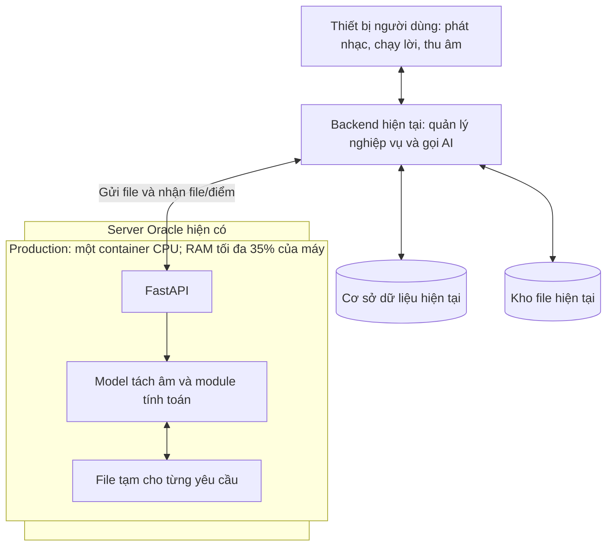

# Kế hoạch cũ 3.1: karaoke API tách nhạc trực tiếp (đã thay thế)

> **Kế hoạch hiện hành để duyệt ngày 28/10/2026:** [Karaoke trên Google Cloud](KE_HOACH_KARAOKE_GOOGLE_CLOUD.md), chuẩn bị GPU local từ mapping MongoDB và kho nguồn từ xa, lưu karaoke trên Google Cloud, FastAPI chỉ chấm điểm. Các địa chỉ Oracle trong tài liệu này là lịch sử.

> **Kế hoạch này đã được thay thế bởi luồng local-preparation 0.3.0.** Tách nhạc và tạo pitch reference chạy thủ công trên máy local, tự chọn tài nguyên; không có worker nền và không chọn profile dev/production ở khâu chuẩn bị. MongoDB/kho file do backend quản lý; FastAPI chỉ chấm điểm sau bài hát. Xem [hướng dẫn mới](KARAOKE_LOCAL_PREPARATION.md) và [schema MongoDB](KARAOKE_MONGODB_SCHEMA.md). Các phần dưới đây là phạm vi/kiểm chứng lịch sử của phiên bản 0.2.0.

**Phiên bản:** 3.1 — cập nhật yêu cầu dev GPU/production 35% ngày 27/10/2026.

**Trạng thái:** Người dùng đã duyệt triển khai. Mã dịch vụ, Dockerfile, launcher, client mẫu và kiểm thử đã được xây dựng. Tình trạng phát hành và số đo thực tế xem [báo cáo triển khai](BAO_CAO_TRIEN_KHAI_KARAOKE.md).

Đây là bản tổng hợp phạm vi đã thống nhất. Yêu cầu bổ sung cuối: **dev dùng GPU NVIDIA, vẫn tối đa 30% RAM; production dùng CPU, nâng trần RAM lên 35%; host production là http://158.178.247.33**. API mặc định cổng 8000; địa chỉ không có cổng cần proxy cổng 80 hoặc đổi cổng phục vụ. Hướng dẫn mã đã triển khai nằm trong [hướng dẫn tích hợp](HUONG_DAN_TICH_HOP_KARAOKE.md). Đánh giá trên Oracle và hiệu chỉnh với người hát thật vẫn cần thực hiện ở hệ thống tương ứng.

## 1. Phương án đã duyệt

Xây dựng một dịch vụ **FastAPI nhận file → chạy model → trả kết quả**, đóng gói model đã huấn luyện bằng **một Dockerfile với biến thể CPU/CUDA**. Mỗi môi trường chọn một image phù hợp; production chỉ pull bản CPU và chạy **một container trên server Oracle hiện có**. Không phát sinh máy chủ hoặc worker GPU riêng.

Backend của bạn quản lý bài hát, dữ liệu, trạng thái, phiên hát và điểm. Thiết bị người dùng phát nhạc, hiển thị lời và thu âm.

| Nội dung | Phương án cuối |
|---|---|
| Server | Oracle hiện có; thông số bạn cung cấp là 2 vCPU, 4 luồng, 24 GB RAM |
| Xử lý AI | Dev GPU NVIDIA qua CUDA, có tùy chọn CPU; production cố định CPU |
| Ngân sách RAM | Dev tối đa 30%; production tối đa 35% RAM trên máy tương ứng |
| Giới hạn thực hiện | Launcher tính theo RAM Docker Engine, mặc định gần 27% cho dev và 31,5% cho production để chừa đệm |
| Model | MelBand RoFormer karaoke aufr33/viperx đã huấn luyện; profile karaoke-v1, kiểm tra hash |
| Đóng gói | Hai tag CPU/CUDA từ cùng Dockerfile, cùng API/model; mỗi môi trường chạy một container |
| Cơ sở dữ liệu | Dùng phần backend đã chuẩn bị; dịch vụ AI không có cơ sở dữ liệu riêng |
| Lưu file lâu dài | Backend/kho file hiện tại |
| File trong container AI | File tạm của từng yêu cầu, trả kết quả xong thì dọn |
| Xử lý đồng thời | Ban đầu một tác vụ âm thanh nặng tại một thời điểm |
| Người dùng có cần máy mạnh/GPU không? | Không chạy model trên máy người hát; thiết bị cần phát nhạc, chạy lời và thu âm được |
| Lời bài hát | Backend cung cấp dữ liệu có mốc thời gian; player chạy lời theo âm thanh |
| Chấm điểm | Module mới, trả điểm sau bài; model tách âm hiện tại chưa chấm điểm |

API là Application Programming Interface — giao diện để các phần mềm gọi nhau. AI là Artificial Intelligence — trí tuệ nhân tạo. CPU là Central Processing Unit — bộ xử lý trung tâm; GPU là Graphics Processing Unit — bộ xử lý đồ họa. RAM là Random Access Memory — bộ nhớ truy cập ngẫu nhiên.

**Kết quả ban đầu:** model đã chạy bằng CPU khi tắt mạng, dưới hard limit của máy dev. Thời gian xử lý còn chậm, cần chuẩn bị bài trước và dùng lại output. Số đo này không thay thế việc đánh giá trên Oracle; không tự tăng ngân sách RAM.

## 2. Kiến trúc và trách nhiệm



| Nơi xử lý | Trách nhiệm |
|---|---|
| Backend | Xác thực người dùng; quản lý bài/phiên/trạng thái/điểm; chống xử lý trùng; gọi AI bằng tác vụ nền; lưu file và cấp dữ liệu cho player |
| Kho file và cơ sở dữ liệu hiện tại | Lưu nhạc gốc, nhạc nền, giọng hướng dẫn, lời có thời gian, bản thu, tham chiếu và lịch sử |
| FastAPI | Xác thực backend; kiểm tra đầu vào; chạy phép tính; trả kết quả; dọn file tạm |
| Player | Phát nhạc, hiển thị lời, xin quyền microphone, thu giọng và gửi về backend |

Model chạy trên máy đặt container. Người hát không phải cài Docker hoặc tải model về. Nếu server đang chạy cả backend, phải đo ảnh hưởng của tác vụ AI lên backend.

Dịch vụ AI không truy cập trực tiếp cơ sở dữ liệu nghiệp vụ. Mỗi yêu cầu gửi đủ file/tham số để tính toán. Thông tin bài, người dùng, phiên hát và trạng thái được lưu ở backend.

## 3. Luồng nghiệp vụ

### 3.1. Chuẩn bị bài karaoke

1. Người dùng chọn bài trên ứng dụng.
2. Backend kiểm tra đã có nhạc nền cho đúng bản nhạc/model/cấu hình chưa.
3. Nếu đã có, dùng kết quả đang lưu.
4. Nếu chưa có, backend ghi nhận tác vụ trong hệ thống của mình và gửi file gốc đến POST /v1/separate.
5. FastAPI tách âm rồi trả nhạc nền, giọng ước lượng và metadata — thông tin mô tả kết quả.
6. Backend lưu file và cập nhật trạng thái.
7. Để chấm điểm, backend gửi giọng gốc đã tách đến POST /v1/references, nhận tham chiếu rồi lưu để dùng lại.
8. Backend cung cấp nhạc nền và lời có thời gian cho player.

Có thể chuẩn bị trước các bài phổ biến. AI không cần tách lại một bài cho từng người hát.

### 3.2. Trong lúc hát

1. Backend tạo phiên hát và chốt phiên bản bài, lời và tham chiếu.
2. Player tải/đệm nhạc và lời.
3. Người dùng cấp quyền microphone, rồi bắt đầu hát.
4. Player phát nhạc, chạy lời theo đồng hồ âm thanh và thu microphone riêng.
5. Giọng hướng dẫn nếu có dùng cùng đồng hồ phát và âm lượng riêng.
6. Sau bài, gửi bản thu về backend.

Phần “real time” trong bản đầu là phát nhạc/hiển thị lời đồng bộ trên player. Model đã tách âm ở bước chuẩn bị.

### 3.3. Sau khi hát

1. Backend lấy bản thu và đúng file tham chiếu.
2. Gửi đến POST /v1/score cùng metadata thời gian thu/phát.
3. FastAPI trả điểm hoặc lý do dữ liệu không đủ điều kiện chấm.
4. Backend lưu kết quả và cung cấp cho người dùng.

Bản chấm đầu áp dụng cho một người hát liên tục, tốc độ gốc và tông gốc.

## 4. Ràng buộc CPU, RAM và cách kiểm chứng

### 4.1. Thông số đã biết và còn cần xác nhận

Bạn cung cấp 2 vCPU, 4 luồng, 24 GB RAM. vCPU là virtual CPU — CPU ảo. Cần xác nhận cách hệ điều hành báo lõi/luồng, không mặc định 4 luồng là 4 lõi vật lý.

Cần thêm hệ điều hành, tên shape — loại cấu hình máy Oracle — và kiến trúc:

| Máy Oracle | Nền tảng image cần xác nhận |
|---|---|
| Intel/AMD 64-bit | linux/amd64 |
| Ampere Arm 64-bit | linux/arm64 |

Oracle có dòng Ampere dùng kiến trúc Arm. Phải kiểm tra các thư viện của repo cài và chạy được trên đúng nền tảng server. [Nguồn: Oracle Arm-Based Compute](https://docs.oracle.com/en-us/iaas/Content/Compute/References/arm.htm).

### 4.2. Sử dụng CPU

Repo đã có chế độ CPU trong [mã chọn thiết bị của Separator](../audio_separator/separator/separator.py).

Đề xuất thử một tiến trình FastAPI, một model được nạp một lần và một yêu cầu tính toán nặng cùng lúc. Bên trong model có thể dùng nhiều luồng CPU, nên một yêu cầu không có nghĩa chỉ dùng một lõi.

Đo trước với 1 và 2 luồng tính toán. Chọn số luồng theo thời gian xử lý, đỉnh RAM và tải backend. Không tăng nhiều tiến trình FastAPI vì mỗi tiến trình có thể nạp thêm một bản model.

Đã thêm cấu hình AI_CPU_THREADS, áp dụng qua torch.set_num_threads trước khi nạp/chạy model. Launcher có --cpu-threads và --cpus để chọn số luồng và ngân sách thời gian CPU theo môi trường. [Nguồn: PyTorch set_num_threads](https://docs.pytorch.org/docs/stable/generated/torch.set_num_threads.html).

Tăng luồng không tạo thêm CPU vật lý, không bảo đảm tăng tốc tương ứng và không bù được thiếu RAM. Hạn mức CPU dành cho AI còn cần chốt sau khi biết tải của backend.

### 4.3. Giới hạn RAM bắt buộc

Ngân sách người dùng đặt ra: **dev tối đa 30%, production tối đa 35% RAM của máy tương ứng**. Không dùng một dung lượng cố định cho mọi máy.

Launcher đọc MemTotal của Docker Engine, lấy trần theo môi trường rồi chừa 10% phần ngân sách làm đệm; mặc định gần **27% RAM cho dev, 31,5% cho production**, làm tròn xuống MiB. MiB là mebibyte theo cơ số 2. Ví dụ máy production báo 24 GB có mức cấp gần 7,56 GB, dưới trần 8,40 GB; Docker Desktop có thể báo RAM thấp hơn RAM máy Windows/macOS.

Launcher cấp --memory và --memory-swap bằng cùng số byte để không dùng thêm swap — bộ nhớ chuyển tạm ra đĩa. Có thể chọn dung lượng cụ thể bằng --memory-mib tới trần. Ứng dụng từ chối khởi động nếu cgroup không có hard limit hoặc cấp quá tỷ lệ cho phép. Nếu dev và production cùng máy, tổng mức cấp của container karaoke do launcher quản lý theo trần chặt hơn, tức 30% khi có dev. VRAM — Video Random Access Memory, bộ nhớ GPU — khác RAM; ngân sách allocator PyTorch GPU mặc định 85% VRAM, không phải hard limit toàn GPU. [Nguồn: Docker Resource Constraints](https://docs.docker.com/engine/containers/resource_constraints/).

Giới hạn tính cho toàn container: model, ứng dụng Python, tensor/buffer và tiến trình xử lý âm thanh. Không chỉ tính kích thước file checkpoint.

Để kiểm soát RAM:

- Một model được nạp một lần và một tác vụ nặng tại một thời điểm.
- Truyền file theo luồng, lưu tạm trên đĩa và giới hạn kích thước/thời lượng đầu vào.
- Đo đỉnh RAM lúc nạp model, lượt suy luận đầu tiên và xử lý các bài đầy đủ.
- Thử giảm batch — số mẫu xử lý cùng lượt — hoặc segment/chunk — đoạn âm thanh — nếu cần; kiểm tra mức giảm RAM thực tế.
- Nếu model không vừa ngân sách, so sánh model nhẹ hơn theo cả chất lượng và tốc độ.

Giảm segment không bảo đảm mọi buffer của toàn bài đều giảm. Khi chạm giới hạn cứng, tiến trình có thể bị dừng do thiếu bộ nhớ. Tiêu chí đạt là chạy ổn có khoảng đệm, không phải chạy sát giới hạn rồi bị dừng.

### 4.4. Quyết định sau giai đoạn đo thử

| Kết quả | Hướng xử lý |
|---|---|
| Vừa RAM, chất lượng và thời gian chờ chấp nhận được | Chốt cấu hình, tiếp tục triển khai |
| Vừa RAM nhưng quá chậm | So sánh cấu hình/model nhẹ hơn; ưu tiên chuẩn bị bài trước và dùng lại |
| Vượt RAM | Điều chỉnh cách xử lý hoặc model rồi đo lại trong cùng giới hạn |
| Không tìm được cấu hình đáp ứng | Báo kết quả và lựa chọn khác trước khi thay đổi phạm vi; không tự tăng RAM hoặc yêu cầu mua GPU |

Chưa có benchmark — kết quả đo thử — trên server Oracle của bạn. Hiện chưa cam kết thời gian tách bài, thời gian chấm hoặc số người sử dụng đồng thời.

## 5. Model và dữ liệu lời

### 5.1. Model tách âm

Tái sử dụng:

- [Separator](../audio_separator/separator/separator.py) và [các adapter](../audio_separator/separator/architectures/) để chạy model.
- [Danh mục model](../audio_separator/models.json) để nhận diện checkpoint/config.
- [Preset karaoke](../audio_separator/ensemble_presets.json) để tham khảo lựa chọn.
- [Điểm benchmark hiện có](../audio_separator/models-scores.json) để tham khảo chất lượng tách, không dùng làm điểm hát.

Ứng viên ban đầu:

```text
mel_band_roformer_karaoke_aufr33_viperx_sdr_10.1956.ckpt
```

Checkpoint là file trọng số đã học; phải đi cùng code mạng và config — cấu hình phù hợp. MelBand RoFormer xử lý các dải tần Mel; RoFormer là tên họ Rotary Position Embedding Transformer, dùng mã hóa vị trí xoay.

Đã chọn checkpoint này cho profile karaoke-v1 đầu tiên sau khi đo CPU/RAM. Mục tiêu là loại giọng chính để tạo nhạc nền; có thể còn bè. Cấu hình thử nghiệm dùng segment_size=128, overlap=2, batch_size=1 và chia đoạn 30 giây để giảm bộ nhớ. Cấu hình khác mặc định model có thể ảnh hưởng chất lượng, cần nghe thử trên kho nhạc mục tiêu. Không chạy ensemble — kết hợp nhiều model — trong bản đầu.

Giọng tách có thể còn bè, âm lọt hoặc méo. Phải kiểm tra có đủ tin cậy làm tham chiếu hay không. Nếu cần đổi/thêm model, đánh giá lại trong cùng ngân sách RAM.

Checkpoint/config được đóng trong image, có nguồn và SHA-256 cố định. Xem [NOTICE](../services/karaoke/NOTICE.md) về nguồn model và thông báo bản quyền phần mềm; không mặc định checkpoint có cùng giấy phép với code.

### 5.2. Lời bài hát

Tách âm thanh giọng hát không tạo ra văn bản lời. Backend cần có lời phù hợp đúng bản phối:

| Dữ liệu | Khả năng hiển thị |
|---|---|
| LRC — định dạng lời có thời gian theo dòng | Làm sáng dòng đang hát |
| JSON (JavaScript Object Notation — định dạng dữ liệu có cấu trúc) theo câu/từ | Làm sáng câu hoặc từ nếu có đủ mốc |
| Chỉ có văn bản lời | Cần bổ sung thời gian |
| Chưa có lời | Cần chuẩn bị nguồn lời để có karaoke chạy chữ |

Player bám theo vị trí phát âm thanh thực tế; nhạc nền và giọng hướng dẫn dùng chung đồng hồ. Trên web có thể dùng Web Audio và trục thời gian currentTime của AudioContext — ngữ cảnh âm thanh. [Nguồn: tài liệu Web Audio](https://developer.mozilla.org/en-US/docs/Web/API/BaseAudioContext/currentTime).

Đầu ra tách âm giữ điểm bắt đầu và thời lượng. Bản đầu ưu tiên WAV (Waveform Audio File Format — định dạng âm thanh dạng sóng) để kiểm chứng đồng bộ. Nếu backend chuyển định dạng để phát, cần kiểm tra độ lệch mã hóa.

## 6. API đã triển khai

Chỉ backend gọi API tính toán. Frontend lấy file, trạng thái, lời và điểm từ hệ thống hiện tại.

| Endpoint | Đầu vào | Đầu ra |
|---|---|---|
| POST /v1/separate | Nhạc gốc, profile xử lý được phép, request_id | File ZIP chứa nhạc nền, giọng và metadata |
| POST /v1/references | File vocals, request_id tùy chọn | reference.json chứa dữ liệu tham chiếu có phiên bản/chất lượng |
| POST /v1/score | Bản thu, reference.json, metadata thu/phát, request_id | JSON điểm hoặc lý do không chấm |
| GET /v1/info | Quyền gọi dịch vụ | Phiên bản model/profile/bộ chấm, thiết bị CPU, số luồng và giới hạn |
| GET /health/live | Kiểm tra vận hành | Tiến trình đang hoạt động |
| GET /health/ready | Kiểm tra vận hành | Model nạp xong, thư mục tạm dùng được |

Nhận file bằng multipart/form-data — yêu cầu mang file cùng trường dữ liệu. Dùng UploadFile và phản hồi file của FastAPI, giới hạn tổng request trước/trong lúc nhận. [Nguồn: FastAPI Request Files](https://fastapi.tiangolo.com/tutorial/request-files/), [FastAPI Custom Response](https://fastapi.tiangolo.com/advanced/custom-response/).

### 6.1. Kết quả tách âm

```text
result.zip
  instrumental.wav
  vocals.wav
  metadata.json
```

Metadata minh họa, không phải số đo đã chạy:

```json
{
  "request_id": "request_demo_001",
  "profile": "karaoke-v1",
  "source_hash": "example_source_hash",
  "model_version": "example_checkpoint_hash",
  "config_version": "example_config_hash",
  "duration_seconds": 240.0,
  "files": {
    "instrumental": "instrumental.wav",
    "vocals": "vocals.wav"
  }
}
```

Vai trò output được ánh xạ theo model đã chọn. File vocals.wav là giọng ước lượng, không mặc định sạch hoàn toàn hoặc chỉ chứa một ca sĩ. Backend kiểm tra và lưu gói file vào kho của mình.

### 6.2. Tham chiếu và metadata thời gian

reference.json chứa cao độ theo thời gian, vùng có giọng, chất lượng, phiên bản cấu trúc và thuật toán. Backend lưu file, gắn với đúng bản nhạc/giọng/model rồi gửi lại khi chấm.

Metadata thu/phát phải xác định mốc bắt đầu thu tương đối với lúc phát, độ trễ hiệu chỉnh nếu có và các gián đoạn. Thời điểm server nhận file không phải lúc người dùng bắt đầu hát.

Dịch vụ kiểm tra cấu trúc, kích thước, giá trị hợp lệ và tính tương thích của tham chiếu. Backend chịu trách nhiệm chọn đúng tham chiếu cho phiên hát.

### 6.3. Kết quả và lỗi

HTTP (Hypertext Transfer Protocol — giao thức trao đổi dữ liệu web) dùng:

| Mã | Ý nghĩa |
|---|---|
| 200 | Xử lý xong; trả file hoặc kết quả đánh giá |
| 401 | Thiếu hoặc không có quyền gọi |
| 413 | File vượt giới hạn |
| 422 | Dữ liệu/định dạng/phiên bản không hợp lệ |
| 503 | Chưa sẵn sàng hoặc đang bận |
| 500 | Lỗi xử lý ngoài dự kiến |

Lời gọi backend → AI chờ đến khi có kết quả. Dịch vụ không tạo job lưu lâu dài hoặc API quản lý bài/phiên. Nếu frontend cần trạng thái “đang xử lý”, backend cung cấp từ dữ liệu của mình.

request_id chỉ dùng đối chiếu yêu cầu/log, không bảo đảm chống chạy trùng. Backend quản lý khóa công việc và thử lại có giới hạn.

## 7. Bộ chấm điểm sau bài

Model hiện tại chưa chấm điểm giọng hát. Điểm có trong tên checkpoint hoặc models-scores.json là điểm chất lượng tách nguồn.

Bổ sung module xử lý tín hiệu trong cùng container:

1. Tạo trước F0 (Fundamental Frequency — tần số cơ bản, liên quan đến cao độ) từ giọng tham chiếu.
2. Kiểm tra bản thu: nhiễu, vỡ tiếng và vùng có giọng.
3. Trích F0 của người hát.
4. Bù độ trễ thu/phát trong giới hạn.
5. So cao độ, nhịp và mức hoàn thành.

Đã dùng librosa.pyin làm đường cơ sở. pYIN (probabilistic YIN — biến thể xác suất của thuật toán YIN) ước lượng cao độ/vùng có giọng, không tự cung cấp điểm karaoke. Module mới tính điểm từ các đặc trưng này; phiên bản pitch-rhythm-v1-experimental. [Nguồn: librosa.pyin](https://librosa.org/doc/0.11.0/generated/librosa.pyin.html).

| Thành phần | Tỷ trọng thử nghiệm |
|---|---:|
| Cao độ | 70% |
| Nhịp | 20% |
| Hoàn thành | 10% |

`Điểm tổng = 0,70 × cao độ + 0,20 × nhịp + 0,10 × hoàn thành`.

Thang điểm thành phần là 0–100. Phải hiệu chỉnh bằng bản thu có người đánh giá trước khi coi là thang điểm sản phẩm đã được kiểm chứng.

Quy tắc chính:

- Không căn thời gian đến mức xóa mất lỗi hát sai nhịp.
- Đề xuất chế độ giải trí cho phép dịch toàn bộ tham chiếu theo quãng tám; không tự sửa từng nốt sai.
- Không chỉ chấm đoạn ngắn tốt nhất rồi bỏ qua phần người dùng không hát.
- Phân biệt lượt hát ít/không hát với bản thu hỏng hoặc quá nhiễu.
- Bài nhiều giọng, bè dày hoặc tham chiếu kém có thể chưa đủ điều kiện chấm.
- Kiểm chứng bằng tai nghe và đo thêm tình huống loa/giọng hướng dẫn lọt vào microphone.
- Điểm phản ánh cao độ/nhịp/mức hoàn thành, không đánh giá toàn bộ kỹ thuật thanh nhạc hay cảm xúc.

Kết quả minh họa:

```json
{
  "request_id": "request_demo_002",
  "status": "completed",
  "score": {
    "overall": 81.2,
    "pitch": 82.0,
    "rhythm": 75.0,
    "coverage": 88.0
  },
  "quality": {
    "status": "sufficient",
    "warnings": []
  },
  "scoring_version": "pitch-rhythm-v1",
  "reference_version": "reference_demo_v1"
}
```

Nếu không đủ dữ liệu đáng tin cậy, trả score là null kèm lý do. Backend lưu kết quả và trạng thái.

## 8. Cách chạy FastAPI và quản lý file tạm

- Một tiến trình Uvicorn — bộ chạy FastAPI.
- Áp dụng số luồng CPU trước khi nạp model; nạp model một lần khi khởi động.
- Dùng lifespan — vòng đời ứng dụng — để quản lý tài nguyên chung. [Nguồn: FastAPI Lifespan Events](https://fastapi.tiangolo.com/advanced/events/).
- Mỗi yêu cầu có thư mục tạm riêng do dịch vụ tự tạo.
- Chỉ một tác vụ âm thanh nặng cùng lúc; đang bận trả 503 để backend điều phối.
- Thực thi phép tính qua luồng xử lý riêng để tránh chặn toàn bộ vòng lặp phục vụ API.
- Trả file rồi mới dọn file tạm; dọn khi lỗi và xử lý file sót an toàn lúc khởi động lại.

| Loại dữ liệu | Nơi giữ |
|---|---|
| Checkpoint/config/metadata tĩnh | Trong image, dự kiến /opt/models |
| Input/output trong yêu cầu | Tạm trên đĩa, dự kiến /tmp/karaoke/<internal-id> |
| Nhạc, tham chiếu, bản thu sau xử lý | Kho file của backend |
| Bài/phiên/trạng thái/điểm | Backend/cơ sở dữ liệu hiện tại |

Không cần volume dữ liệu bền vững của dịch vụ AI. Cần giới hạn dung lượng thư mục tạm và lượt upload/download; tránh giữ toàn bộ file trong RAM chỉ để truyền tải.

Backend giữ khóa gọi dịch vụ trên server. Người dùng không gọi trực tiếp các endpoint xử lý bằng khóa này. Dịch vụ nhận file trực tiếp, không nhận đường dẫn tùy ý hoặc tự tải từ mọi địa chỉ bên ngoài.

Backend chạy lời gọi AI trong tác vụ nền và quản lý timeout — thời gian chờ — của client/proxy theo số đo, có giới hạn. HTTPX có các loại timeout kết nối/đọc/ghi/chờ kết nối. [Nguồn: HTTPX Timeouts](https://www.python-httpx.org/advanced/timeouts/).

Nếu container dừng hoặc phản hồi bị mất, backend nhận lỗi và quyết định thử lại. Không khôi phục suy luận từ giữa bài. Mất kết nối không bảo đảm phép tính dừng ngay; chỉ cấp lượt xử lý mới khi phép tính cũ thực sự kết thúc.

## 9. Docker image và phát hành

Các tag đã chọn: **dreayrt/audio_separator_for_karaoke:0.2.0** cho CPU và **dreayrt/audio_separator_for_karaoke:0.2.0-gpu** cho dev GPU. Tình trạng push/digest và nền tảng kiểm chứng được ghi trong báo cáo triển khai.

Chứa FastAPI, Uvicorn, audio-separator, PyTorch/runtime CPU, FFmpeg, module tham chiếu/chấm điểm và checkpoint/config/metadata đã chốt.

Repo có cơ chế tải thêm model/danh mục nếu thiếu. Khi build phải chuẩn bị đủ file liên quan, không chỉ một file trọng số. Kiểm tra container khởi động/xử lý khi chặn tải model/config/metadata từ bên ngoài.

Bản CPU build linux/amd64 và linux/arm64; bản dev CUDA build linux/amd64 cho GPU NVIDIA đã có trên máy dev. Thay bộ PyTorch bằng build argument TORCH_INDEX_URL trong cùng Dockerfile. Chạy benchmark trên Oracle trước khi chốt tốc độ; build được cho Arm chưa đồng nghĩa có số đo Arm thực tế. Model được dùng trực tiếp, không huấn luyện lại. [Nguồn: PyTorch](https://docs.pytorch.org/get-started/previous-versions/), [Docker GPU](https://docs.docker.com/engine/containers/gpu/).

Quy trình phát hành và sử dụng:

1. Dùng một Dockerfile.karaoke cho hai tag CPU/CUDA cùng code/model.
2. Build/kiểm tra dev GPU tối đa 30% RAM và production CPU tối đa 35% RAM, theo máy chạy.
3. Tag phiên bản rồi push vào Docker Hub của bạn.
4. Pull image trên server Oracle và chạy một container.
5. Backend gọi kiểm tra sẵn sàng, sau đó dùng API.

Lệnh build và chạy với launcher đã triển khai:

```sh
docker buildx build --platform linux/amd64,linux/arm64 -f Dockerfile.karaoke -t dreayrt/audio_separator_for_karaoke:0.2.0 --push .
docker buildx build --platform linux/amd64 -f Dockerfile.karaoke --build-arg TORCH_INDEX_URL=https://download.pytorch.org/whl/cu126 -t dreayrt/audio_separator_for_karaoke:0.2.0-gpu --push .

python -m services.karaoke.tools.launch --env dev --port 18000
# Chạy trên Oracle:
docker pull dreayrt/audio_separator_for_karaoke:0.2.0
python -m services.karaoke.tools.launch --env production --port 8000
```

Các lệnh chạy trên máy tương ứng. Dev mặc định GPU, tag -gpu, --gpus all, bind 127.0.0.1; thêm --device cpu nếu cần. Production luôn CPU, bind 0.0.0.0, URL mặc định http://158.178.247.33:8000; có thể ghi đè URL client bằng --url/KARAOKE_API_URL và chọn --bind theo hạ tầng. Chưa tự cấu hình firewall hoặc proxy trên server.

Launcher tạo file .env.karaoke.dev.local hoặc .env.karaoke.production.local chứa khóa ngẫu nhiên và cấu hình riêng, nằm ngoài Git/image. Ngân sách CPU được điều chỉnh bằng --cpus và --cpu-threads.

Docker Hub lưu image; container phải chạy để backend gọi API. Khi không dùng có thể dừng. Cập nhật checkpoint bằng phiên bản image mới và giữ phiên bản trước để quay về khi cần. [Nguồn: Docker Hub push image](https://docs.docker.com/docker-hub/repos/manage/hub-images/push/), [FastAPI trong Docker](https://fastapi.tiangolo.com/deployment/docker/).

## 10. Các giai đoạn triển khai và bàn giao

| Giai đoạn | Công việc | Điều kiện/kết quả |
|---|---|---|
| 0. Kiểm chứng khả thi | Đo CPU/GPU với trần RAM theo môi trường, nạp model/lượt đầu/bài dài | Số đo có trong báo cáo; tốc độ/chất lượng/tải backend trên Oracle còn cần xác nhận |
| 1. API tách âm | Nhận file, gọi Separator, trả ZIP/metadata, xác thực, giới hạn tải và dọn tạm | Backend gửi bài và lưu được output hợp lệ |
| 2. Tham chiếu/chấm điểm | Tạo và đọc tham chiếu, xử lý bản thu, bù độ trễ, tính điểm, kiểm tra chất lượng | API cùng bộ bản thu kiểm chứng và phiên bản công thức |
| 3. Tích hợp karaoke | Mẫu gọi backend; đối chiếu lưu file/trạng thái, player, lời và thu âm | Hướng dẫn đầu cuối và phần cần chỉnh ở hệ thống hiện tại |
| 4. Đóng gói/phát hành | Image có model, kiểm tra pull/run trên máy mục tiêu và publish Docker Hub | Một image CPU cùng tài liệu sử dụng |

Bộ file đã xây dựng:

```text
services/karaoke/
  api.py               # Endpoint và xác thực backend
  engine.py            # Model CPU, dùng tài sản đóng gói
  audio.py             # Kiểm tra, giải mã audio
  scoring.py           # Tham chiếu, cao độ, nhịp, mức hoàn thành
  runtime.py           # Một lượt xử lý, file tạm, ngắt kết nối
  config.py            # Cấu hình môi trường
  assets.py            # Hash và hồ sơ checkpoint
  resources.py         # Chính sách RAM
  tools/               # Chuẩn bị model, launcher, đo, smoke test
  examples/            # Mẫu gọi từ backend
  tests/               # Kiểm thử hợp đồng/tính toán
Dockerfile.karaoke
.env.karaoke.example
docs/HUONG_DAN_TICH_HOP_KARAOKE.md
```

Đây là các module trong cùng dịch vụ. Không xây thêm hệ thống quản lý dữ liệu nghiệp vụ.

Việc sửa trực tiếp backend/frontend hiện tại cần mã nguồn hoặc hợp đồng của hệ thống đó. Phần có thể bàn giao độc lập trong repo này là dịch vụ AI, image, tài liệu và mẫu gọi.

Chưa chốt số ngày hoặc chi phí. Sau giai đoạn 0, ước lượng dựa trên số đo, dữ liệu hiệu chỉnh và phạm vi tích hợp.

## 11. Tiêu chí nghiệm thu

| Nhóm | Điều kiện |
|---|---|
| Oracle CPU | Đúng kiến trúc, chạy không cần GPU; số luồng cấu hình có hiệu lực |
| RAM | Hard limit tính theo máy: dev tối đa 30%, production tối đa 35%; không cấp thêm swap |
| Đóng gói | Pull/run một container có đủ model/config/metadata; không tải thêm khi chạy |
| Tách âm | Đủ file, đọc được, giữ trục thời gian và đạt chất lượng nghe thử đã thống nhất |
| File tạm | Thư mục riêng, giới hạn dung lượng, dọn sau phản hồi/lỗi |
| Backend | Quản lý dữ liệu, trạng thái, chống trùng, lưu kết quả và điều phối thử lại |
| API | Đúng hợp đồng, thông báo lỗi rõ; khi bận trả 503 |
| Tham chiếu | Có phiên bản, kiểm tra cấu trúc/chất lượng; backend lưu và gửi lại được |
| Chấm điểm | Có bộ bản thu chuẩn/sai nốt/sai nhịp/hát thiếu/im lặng; công bố phạm vi và phiên bản thang điểm |
| Người dùng | Phát nhạc, chạy lời, thu âm mà không cài model/Docker |
| Quyền truy cập | Chỉ backend được gọi xử lý; không lộ khóa hoặc mở đường dẫn file tùy ý |
| Tích hợp | Chọn bài → chuẩn bị → phát/thu → chấm → backend lưu/hiển thị kết quả |
| Bàn giao | Có cấu hình, tài liệu API, mẫu gọi và hướng dẫn build/push/pull/run |

Theo dõi thời gian tách/chấm/truyền file, đỉnh RAM, tải CPU/backend và lỗi. RTF (Real-Time Factor — thời gian xử lý chia thời lượng âm thanh) dùng để so tốc độ, không tự suy ra khả năng stream trực tiếp.

Các giới hạn cần công bố: bài nhiều giọng có thể chưa chấm được; thiếu lời có thời gian thì chưa chạy chữ đồng bộ; chưa có bộ hiệu chỉnh thì điểm còn ở mức thử nghiệm.

Chức năng tự nhận dạng/căn lời tiếng Việt, chấm trực tiếp trong lúc hát, đổi tông/tốc độ khi chấm, song ca và đánh giá cảm xúc/phát âm thuộc phạm vi mở rộng.

## 12. Phạm vi đã chốt và phần cần đánh giá trên hệ thống thực tế

### 12.1. Yêu cầu đã thống nhất trong bản kế hoạch

- Một Dockerfile với tag CPU/CUDA cùng code/model; mỗi môi trường chạy một container.
- Dev mặc định GPU NVIDIA, có tùy chọn CPU; production CPU trên Oracle hiện có.
- RAM AI dev tối đa 30%, production tối đa 35%; mức cấp mặc định gần 27%/31,5% để chừa đệm.
- Backend sở hữu dữ liệu, trạng thái, file, phiên hát và điểm.
- FastAPI nhận file, tính toán, trả kết quả và chỉ giữ file tạm.
- Người hát không chạy model; nhạc/lời/thu âm do ứng dụng hiện tại thực hiện.
- Model hiện có chỉ tách âm; bộ chấm điểm được xây thêm và kiểm chứng riêng.
- Người dùng đã duyệt thực thi; xem báo cáo để phân biệt kết quả đã kiểm chứng với phần tích hợp còn phụ thuộc hệ thống hiện có.

### 12.2. Đề xuất và thông tin cần chốt

| Nội dung | Đề xuất hoặc đầu vào cần có |
|---|---|
| Phạm vi | Giai đoạn 0–4 theo kế hoạch; tiếp tục phần sau khi kiểm chứng tài nguyên đạt |
| Giới hạn RAM | Tự tính theo Docker Engine: dev tối đa 30%, production tối đa 35% |
| CPU | Xác nhận shape/kiến trúc/hệ điều hành và số lõi/luồng; chốt phần CPU dành cho AI |
| Tốc độ | Thời gian chờ chấp nhận được, số bài mới và nhu cầu chấm điểm |
| Model/nhạc nền | Profile karaoke-v1 đã chọn; cần nghe thử trên kho nhạc sử dụng thực tế |
| Backend | Hợp đồng gửi/nhận file, điều phối tác vụ, xác thực và lưu phiên bản |
| Lời/player | Nguồn lời có thời gian, nền tảng và metadata thu/phát |
| Điểm | Duyệt công thức thử 70% cao độ, 20% nhịp, 10% hoàn thành và chính sách lệch quãng tám |
| Docker Hub | dreayrt/audio_separator_for_karaoke; xem tình trạng phát hành trong báo cáo |

Không cần duyệt lại các công việc đã được cho phép. Chưa có quyền truy cập Oracle hoặc mã backend/frontend tương ứng trong repo này, nên việc triển khai trên máy đó và hiệu chỉnh điểm với bản thu thực cần tiếp tục ở môi trường của bạn. Không suy ra các việc đó đã hoàn thành chỉ vì image build/push thành công.
