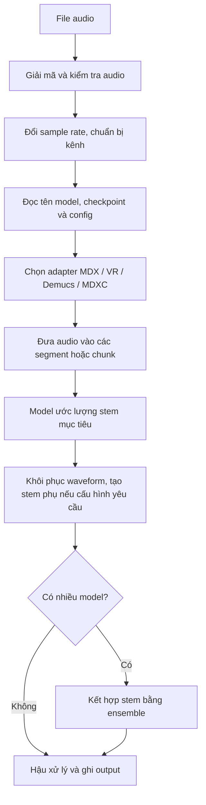

# Các mô hình tách âm thanh trong hệ thống

Tài liệu này giải thích model là gì, cách các model học và chạy, vai trò của từng họ model trong `python-audio-separator`, và giới hạn nào hệ thống có thể cam kết. Nội dung được đối chiếu với mã nguồn và danh mục model hiện có trong repository.

## Tóm tắt nhanh

- **Model** là mạng đã được huấn luyện để ước lượng một hoặc nhiều phần âm thanh từ bản phối gốc.
- Trong repo này, người dùng chủ yếu **chọn và chạy model đã huấn luyện**. Dữ liệu huấn luyện, quy trình train và loss cụ thể của từng checkpoint không được cung cấp đầy đủ ở đây.
- Hệ thống hỗ trợ bốn adapter suy luận chính: MDX (nhãn model không có khai triển chính thức), VR (**Vocal Remover**), Demucs (tên riêng) và MDXC (nhãn adapter trong code). MDX23C (tên nhánh model không có khai triển trong repo) và RoFormer (**Rotary Position Embedding Transformer**) được điều phối qua MDXC.
- Model quyết định stem/tác vụ mục tiêu. Loader đọc thông tin model rồi chuyển tới adapter tương ứng.
- Hệ thống cam kết xử lý theo cấu hình và xuất file nếu inference thành công; nó **không cam kết** tách sạch tuyệt đối, không có artifact, hoặc đạt một mức SDR (**Signal-to-Distortion Ratio**, tỷ lệ tín hiệu trên méo) cố định cho mọi bài hát.

## Chữ viết tắt trong tài liệu

| Chữ viết tắt/tên | Tên đầy đủ và chú thích |
|---|---|
| **MDX / MDX23C / MDXC** | Tên họ/nhãn model trong repository; code không cung cấp khai triển chính thức cho các chữ này nên tài liệu không tự đoán nghĩa. |
| **VR** | **Vocal Remover** — họ kiến trúc UVR dùng trong dự án. |
| **UVR** | **Ultimate Vocal Remover** — tên ứng dụng/hệ sinh thái có các model tách âm mà package hỗ trợ. |
| **Demucs** | Tên riêng của họ model tách nguồn, không phải chữ viết tắt. |
| **RoFormer** | **Rotary Position Embedding Transformer** — họ Transformer sử dụng mã hóa vị trí xoay. |
| **RoPE** | **Rotary Position Embedding** — cách đưa vị trí vào Transformer bằng phép xoay. |
| **BS-RoFormer** | **Band-Split RoPE Transformer** — RoFormer chia phổ thành các dải để xử lý tách nguồn. |
| **ONNX** | **Open Neural Network Exchange** — định dạng mở biểu diễn/trao đổi model máy học giữa các công cụ/runtime. |
| **YAML** | **YAML Ain't Markup Language** — định dạng văn bản dễ đọc để lưu cấu hình. |
| **STFT / ISTFT** | **Short-Time Fourier Transform** (biến đổi Fourier ngắn hạn sang phổ) / **Inverse Short-Time Fourier Transform** (biến đổi ngược phổ thành waveform). |
| **SDR** | **Signal-to-Distortion Ratio** — tỷ lệ tín hiệu trên méo, điểm benchmark tổng thể so với stem tham chiếu. |
| **TTA** | **Test-Time Augmentation** — biến đổi input trong inference rồi tổng hợp dự đoán; có thể tăng thời gian chạy. |
| **BVE** | **Backing Vocal Extraction** — tách bè/giọng hát phụ; đây là nhãn trong tên model UVR-BVE. |
| **CLI / API** | **Command-Line Interface** (giao diện dòng lệnh) / **Application Programming Interface** (giao diện lập trình ứng dụng). |

Các hậu tố như `V1`, `V2`, `FT`, `FV`, `HQ`, `INST` thường biểu thị phiên bản, bản tinh chỉnh, chất lượng theo cách đặt tên của tác giả hoặc mục tiêu instrumental. `FV`, `SYHFT`, `SW` và một số mã tác giả không được giải nghĩa chính thức trong repo; hãy xem chúng là tên model, không phải cam kết chất lượng.

## 1. “Model” nghĩa là gì?

Hãy hình dung một bản nhạc là nhiều nhạc cụ và giọng hát đang chồng lên nhau. Model tách âm thanh là bộ tham số đã học cách nhận ra mẫu của một loại nguồn âm trong bản phối, rồi tạo ra một ước lượng riêng cho nguồn đó.

Ví dụ, một model karaoke được huấn luyện để ước lượng phần nhạc cụ/nhạc nền khi giọng chính bị loại ra. Model vocals thì ước lượng phần giọng. Một model Demucs nhiều stem có thể đồng thời ước lượng vocals, drums, bass và other.

Các khái niệm không nên nhầm lẫn:

| Khái niệm | Ý nghĩa |
|---|---|
| **Họ kiến trúc** | Cách thiết kế và chạy mạng, ví dụ MDX (nhãn model không có khai triển chính thức), VR (**Vocal Remover**), Demucs (tên riêng) hoặc RoFormer (**Rotary Position Embedding Transformer**). |
| **Checkpoint** | File trọng số đã học (`.onnx`, `.pth`, `.ckpt`); chứa các tham số mà model dùng khi suy luận. |
| **Config** | Thiết lập khớp với checkpoint, thường gồm sample rate, số stem, dải tần, độ dài segment và tên stem. |
| **Model cụ thể** | Kết hợp kiến trúc + checkpoint + config. Hai checkpoint cùng họ vẫn có thể nhắm mục tiêu và cho chất lượng khác nhau. |
| **Inference** | Dùng checkpoint đã học để xử lý file mới. Đây là luồng chính của package. |

## 2. Model học như thế nào?

### Nguyên lý huấn luyện phổ biến

Nhiều model tách nhạc được huấn luyện theo cách có dữ liệu mẫu đúng (supervised learning):

1. Chuẩn bị các stem riêng như giọng hát, bass và trống.
2. Trộn các stem thành một bản phối đầu vào: `mix = vocals + bass + drums + ...`.
3. Đưa bản phối vào mạng để mạng dự đoán stem mục tiêu.
4. So sánh dự đoán với stem chuẩn, tính sai số (loss), rồi cập nhật trọng số để các dự đoán sau gần với mẫu chuẩn hơn.
5. Lặp lại trên nhiều bài/đoạn nhạc. Sau huấn luyện, trọng số được lưu trong checkpoint.

Ở bước sử dụng, model không “học lại” từ bài nhạc của người dùng. Nó áp dụng trọng số có sẵn để ước lượng stem cho input mới.

### Điều biết và chưa biết về checkpoint trong repository

Repo có loader, adapter inference, config và danh mục checkpoint. Tên model thường cho biết tác vụ hoặc biến thể (ví dụ `karaoke`, `denoise`, `dereverb`, `bleedless`, `fullness`, `V2`), nhưng tên đó không đủ để xác định:

- Bộ dữ liệu huấn luyện chính xác.
- Loss function và cách cân trọng số giữa các loss.
- Số epoch, chiến lược augmentation và toàn bộ tham số train.
- Kết quả của model trên mọi thể loại nhạc hoặc mọi input.

Các thông tin này tùy checkpoint và thường do tác giả model công bố bên ngoài repo. Có một số code thư viện/vendor phục vụ Demucs, nhưng repo không cung cấp một pipeline kèm dữ liệu để tái tạo quá trình huấn luyện toàn bộ model trong danh mục. Do đó, phần mô tả training ở trên là nguyên lý chung, không phải cam kết rằng mọi checkpoint đều được huấn luyện theo đúng cùng một quy trình.

## 3. Luồng hoạt động khi chạy model

### Các bước trong code

1. `Separator.separate()` nhận file, danh sách file hoặc thư mục.
2. Audio được giải mã, kiểm tra dữ liệu và chuẩn bị về sample rate/kênh mà model cần.
3. `Separator.load_model()` tra danh mục và metadata, tải checkpoint/config nếu chưa có trong cache, rồi chọn adapter theo kiến trúc.
4. Adapter chia input thành các đoạn phù hợp với model. File dài có thể được chia thành chunk lớn hơn bằng tùy chọn `chunk_duration`.
5. Mạng tạo ra một hay nhiều dự đoán. Cách tính cụ thể phụ thuộc kiến trúc và cấu hình checkpoint.
6. Kết quả được dựng về waveform. Với một số model chỉ dự đoán một stem, implementation có thể tính stem còn lại bằng phép trừ `mix - stem_mục_tiêu`.
7. Nếu người dùng chọn nhiều model, hệ thống chạy từng model rồi kết hợp các stem tương ứng bằng ensemble.
8. Hậu xử lý theo tùy chọn, sau đó ghi các file stem ra thư mục output.

## 4. Các họ model và nhiệm vụ trong hệ thống

| Họ model | Tệp thường dùng | Cách suy luận khái quát | Nhiệm vụ thường thấy |
|---|---|---|---|
| **MDX** (nhãn model trong repo, không có khai triển acronym chính thức) | `.onnx` | Adapter gọi ONNX (**Open Neural Network Exchange**, định dạng mở biểu diễn model) Runtime. Model xử lý các cửa sổ âm thanh/đặc trưng phổ rồi dựng lại waveform. | Tách instrumental/vocals; thường nhanh và có model chuyên karaoke. |
| **VR** (**Vocal Remover**) | `.pth` | Adapter PyTorch chuẩn bị đặc trưng phổ theo cấu hình model rồi chạy mạng UVR (**Ultimate Vocal Remover**) trên các cửa sổ. | Tách một stem theo mục tiêu của model; danh mục có cả model giảm vang và BVE (**Backing Vocal Extraction**, tách bè/giọng phụ). |
| **Demucs** (tên riêng, không phải acronym) | `.yaml` cùng trọng số tải về | Adapter dùng mạng Demucs và xử lý theo segment. YAML (**YAML Ain't Markup Language**, định dạng cấu hình dạng văn bản) mô tả model. HTDemucs (**Hybrid Transformer Demucs**) kết hợp waveform và biểu diễn phổ. | Tách nhiều stem cùng lượt, thường là vocals/drums/bass/other hoặc bản 6 stem. |
| **MDXC / RoFormer** (MDXC là nhãn code; RoFormer là **Rotary Position Embedding Transformer**) | `.ckpt` và YAML | Adapter PyTorch nạp cấu hình/checkpoint; RoFormer chuyển audio qua STFT (**Short-Time Fourier Transform**), chia đặc trưng theo dải, dùng attention theo thời gian/tần số để ước lượng mask rồi dùng ISTFT (**Inverse Short-Time Fourier Transform**) khôi phục waveform. | Tách vocals/instrumental/karaoke, giảm vang, giảm nhiễu và một số tác vụ chuyên biệt. |

`MDX23C` là tên nhánh model dùng checkpoint/config riêng; repository không khai triển chữ viết tắt này. Hệ thống điều phối nhánh đó qua adapter MDXC. Trong code, loại adapter được ánh xạ trong `Separator.load_model()`; model config cho biết số stem và target cụ thể.

### 4.1 MDX

MDX là đường suy luận dựa trên ONNX Runtime. Adapter chia audio thành các segment, chuẩn hóa/đệm theo yêu cầu model, chạy mạng rồi ghép phần dự đoán lại. File ONNX chứa trọng số và graph của mạng; tham số inference đi kèm được lấy từ metadata của model.

Trong registry hiện tại có `UVR-MDX-NET-Inst_HQ_5.onnx`, nhắm tới nhạc nền/instrumental. Tốc độ thực tế phụ thuộc model, ONNX execution provider, thiết bị và kích thước input.

### 4.2 VR

VR là họ kiến trúc UVR chạy qua PyTorch. Đường xử lý dùng các cấu hình model như sample rate, cửa sổ, số band/tần số và tham số riêng. Một số tùy chọn như TTA hay hậu xử lý có thể làm kết quả khác đi nhưng tăng thời gian.

Các ví dụ trong registry là `UVR-De-Reverb-aufr33-jarredou.pth` (giảm vang) và `UVR-BVE-4B_SN-44100-2.pth` (nhánh BVE, thường dùng cho tách bè/giọng phụ theo metadata). Stem chính xác nên xem bằng `--list_models`.

### 4.3 Demucs

Demucs nhận waveform và dự đoán danh sách nguồn được cấu hình. HTDemucs dùng cấu trúc hybrid để tận dụng waveform lẫn thông tin miền phổ. Adapter ánh xạ chỉ số nguồn từ output model thành các tên stem như `Vocals`, `Drums`, `Bass`, `Other`, `Guitar`, `Piano`.

Model 4 stem xuất vocals/drums/bass/other; `htdemucs_6s.yaml` có thể xuất thêm guitar và piano. Tên stem và số stem được quyết định từ cấu hình model chứ không phải mọi Demucs đều xuất cùng danh sách.

### 4.4 MDXC và RoFormer

Các checkpoint MDXC được nạp với cấu hình YAML tương ứng. RoFormer trong repo nhận waveform, tính STFT, tổ chức đặc trưng theo dải tần, rồi dùng các khối attention để học liên hệ giữa các thời điểm và vùng tần số. Bộ dự đoán tạo mask cho từng stem; mask được áp dụng lên biểu diễn phổ và ISTFT trả kết quả về waveform.

BS-RoFormer và MelBand RoFormer khác nhau ở cách chia/biểu diễn các dải tần. Nhiều checkpoint trong danh mục thuộc họ này vì có các bản chuyên vocals, instrumental, karaoke, de-reverb, denoise, crowd, aspiration và giảm âm lọt.

## 5. Model đảm nhiệm chức năng gì trong hệ thống?

“Đảm bảo” ở đây nói về **vai trò trong luồng phần mềm**, không phải cam kết model tạo ra bản tách hoàn hảo.

| Tầng | Vai trò được thực hiện |
|---|---|
| **Model registry** | Cho biết checkpoint/config nào có thể dùng, kiến trúc nào sẽ chạy và thông tin stem/điểm tham chiếu nếu có. |
| **Model loader** | Tìm hoặc tải file cần thiết, đọc config/metadata, khởi tạo adapter phù hợp và giữ model trong bộ nhớ để tái sử dụng ở các đường hỗ trợ. |
| **Architecture adapter** | Chuyển audio sang định dạng mà kiến trúc cần, gọi backend, chạy inference và chuyển output thành waveform/stem. |
| **Stem mapping** | Gắn output tensor của model với tên stem mà người dùng thấy; với model một target, một số đường xử lý dựng stem còn lại từ phần residual. |
| **Ensemble (tùy chọn)** | Kết hợp kết quả của nhiều model để người dùng thử cân bằng giữa sạch, đầy và artifact. |
| **Audio writer** | Chuẩn hóa theo cấu hình, mã hóa và xuất file theo định dạng/thư mục đã chọn. |

### Điều hệ thống có thể và không thể cam kết

Hệ thống có thể cam kết các chức năng phần mềm sau khi chạy thành công: chọn adapter theo model, nạp config/checkpoint, chạy luồng inference tương ứng, ánh xạ stem theo metadata và ghi output. Nếu chọn một stem duy nhất, output chỉ chứa stem được yêu cầu.

Hệ thống không thể cam kết tách âm tuyệt đối. Các giọng hòa âm, hiệu ứng, reverb, distortion, âm sắc giống nhau giữa nhạc cụ hoặc dữ liệu ngoài miền train có thể làm âm thanh lọt sang stem khác, mất chi tiết hoặc tạo artifact. SDR trong danh mục là điểm tham chiếu benchmark; nó không bảo đảm cùng điểm số trên file mới. Cần nghe kết quả và chọn model theo bài hát/mục đích.

## 6. Thống kê danh mục model hiện tại

Trong checkout hiện tại, `audio_separator/models.json` có **89 mục tải model**:

| Nhóm registry | Số mục | Ví dụ và chức năng |
|---|---:|---|
| VR | 2 | De-Reverb và BVE. |
| MDX | 1 | MDX-Net Inst HQ 5, tách instrumental. |
| MDX23C | 2 | De-Reverb và DrumSep. |
| RoFormer/MDXC | 84 | Karaoke, vocals, instrumental, de-reverb, de-echo, denoise, debleed, crowd, aspiration và biến thể khác. |

Ngoài các mục này, danh mục từ nguồn model UVR có các cấu hình Demucs v4 như `htdemucs`, `htdemucs_ft`, `htdemucs_mmi` và `htdemucs_6s`. Model mặc định trong CLI/API hiện là `model_bs_roformer_ep_317_sdr_12.9755.ckpt`.

### Các nhóm tác vụ RoFormer

| Mục đích | Ví dụ checkpoint | Ý nghĩa tên/nhóm |
|---|---|---|
| Karaoke / loại giọng chính | `mel_band_roformer_karaoke_aufr33_viperx_sdr_10.1956.ckpt`, `mel_band_roformer_karaoke_gabox_v2.ckpt`, `mel_band_roformer_karaoke_becruily.ckpt` | Tạo nhạc nền bằng cách dự đoán/loại phần vocals theo cách model được huấn luyện. |
| Tách vocals | `bs_roformer_vocals_resurrection_unwa.ckpt`, `bs_roformer_vocals_revive_v2_unwa.ckpt`, `mel_band_roformer_vocals_gabox.ckpt` | Giữ lại phần giọng hát; các bản khác nhau là checkpoint/fine-tune riêng. |
| Tách instrumental | `bs_roformer_instrumental_resurrection_unwa.ckpt`, `mel_band_roformer_instrumental_becruily.ckpt`, `mel_band_roformer_instrumental_fv7z_gabox.ckpt` | Giữ phần nhạc cụ/nhạc nền; mức bleed và fullness khác nhau. |
| Giảm vang | `deverb_bs_roformer_8_384dim_10depth.ckpt`, `dereverb_mel_band_roformer_anvuew_sdr_19.1729.ckpt` | Ước lượng phần âm có vang để giảm/loại khỏi kết quả tùy cấu hình. |
| Khử nhiễu/giảm âm lọt | `denoise_mel_band_roformer_aufr33_sdr_27.9959.ckpt`, `mel_band_roformer_denoise_debleed_gabox.ckpt`, `mel_band_roformer_bleed_suppressor_v1.ckpt` | Nhắm vào noise hoặc âm thanh của stem khác bị lọt. |
| Âm đám đông/tiếng thở/chorus | `mel_band_roformer_crowd_aufr33_viperx_sdr_8.7144.ckpt`, `aspiration_mel_band_roformer_sdr_18.9845.ckpt`, `model_chorus_bs_roformer_ep_267_sdr_24.1275.ckpt` | Tác vụ hẹp hơn: crowd, aspiration/tiếng thở hoặc chorus/giọng chồng. |

Danh sách checkpoint đầy đủ cùng mô tả từng biến thể nằm trong [tổng quan kỹ thuật hệ thống](TONG_QUAN_KY_THUAT_HE_THONG.md), còn danh mục có thể dùng trực tiếp bằng `audio-separator --list_models`. Nên dùng `--list_filter vocals`, `instrumental`, `drums`, v.v. để tìm model theo stem.

## 7. Chọn model theo nhu cầu

| Nhu cầu | Điểm bắt đầu |
|---|---|
| Làm karaoke, giảm giọng chính | Dùng một checkpoint karaoke hoặc preset `karaoke`; nghe kiểm tra bè và reverb còn sót. |
| Lấy vocals | Chọn model có `Vocals` là stem mục tiêu; thử model cân bằng trước, rồi chọn bản bleedless/fullness tùy yêu cầu. |
| Lấy instrumental sạch | Thử preset `instrumental_clean` hoặc model instrumental có định hướng giảm bleed. |
| Giữ tiếng nhạc cụ đầy | Thử model/preset thiên về fullness; chấp nhận khả năng còn vocal bleed/nhiễu cao hơn. |
| Tách trống/bass/guitar/piano cùng lúc | Thử model Demucs nhiều stem, ví dụ `htdemucs` hoặc `htdemucs_6s`. |
| Giảm vang hoặc nhiễu | Chọn checkpoint có `dereverb`, `deverb` hoặc `denoise` trong tên; đó là tác vụ riêng, không đồng nghĩa với tách vocals/instrumental thông thường. |

Preset là gợi ý cấu hình, không phải bảo đảm kết quả. Thay đổi model, thuật toán ensemble, sample rate và thiết bị có thể làm thay đổi output hoặc thời gian chạy.

## 8. File nguồn để xem thêm

- [`audio_separator/separator/separator.py`](../audio_separator/separator/separator.py): chọn/tải model, định tuyến adapter, inference tổng thể và ensemble.
- [`audio_separator/separator/architectures/`](../audio_separator/separator/architectures/): adapter MDX, VR, Demucs và MDXC.
- [`audio_separator/separator/uvr_lib_v5/roformer/bs_roformer.py`](../audio_separator/separator/uvr_lib_v5/roformer/bs_roformer.py): luồng STFT, band split, attention, mask và ISTFT của BS-RoFormer.
- [`audio_separator/models.json`](../audio_separator/models.json): model checkpoint/config được package khai báo.
- [`audio_separator/model-data.json`](../audio_separator/model-data.json): metadata hỗ trợ nhận diện model/stem.
- [`audio_separator/models-scores.json`](../audio_separator/models-scores.json): điểm benchmark tham chiếu, không phải điểm inference của input mới.
- [`audio_separator/ensemble_presets.json`](../audio_separator/ensemble_presets.json): các preset kết hợp model hiện có.
- [Tổng quan kỹ thuật hệ thống](TONG_QUAN_KY_THUAT_HE_THONG.md): cách chạy, chỉ số runtime và danh sách checkpoint chi tiết hơn.
