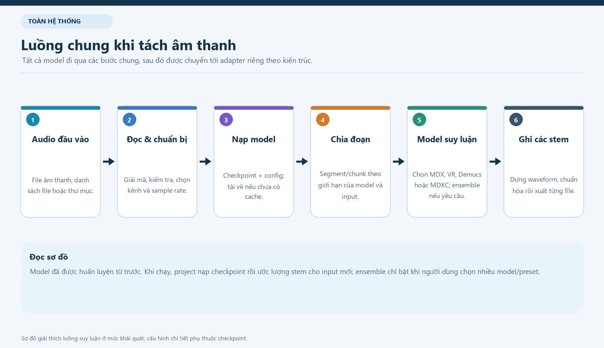
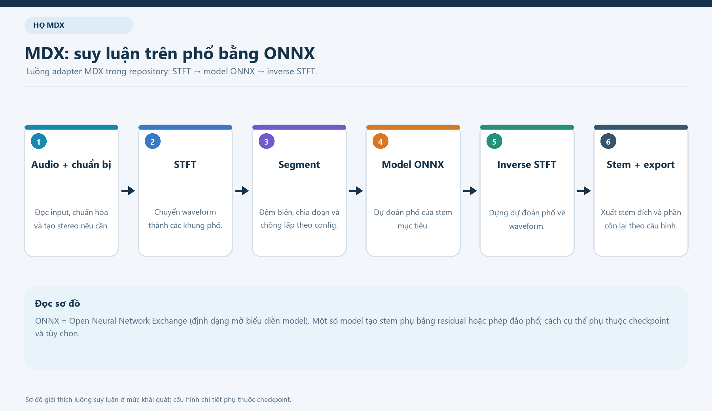
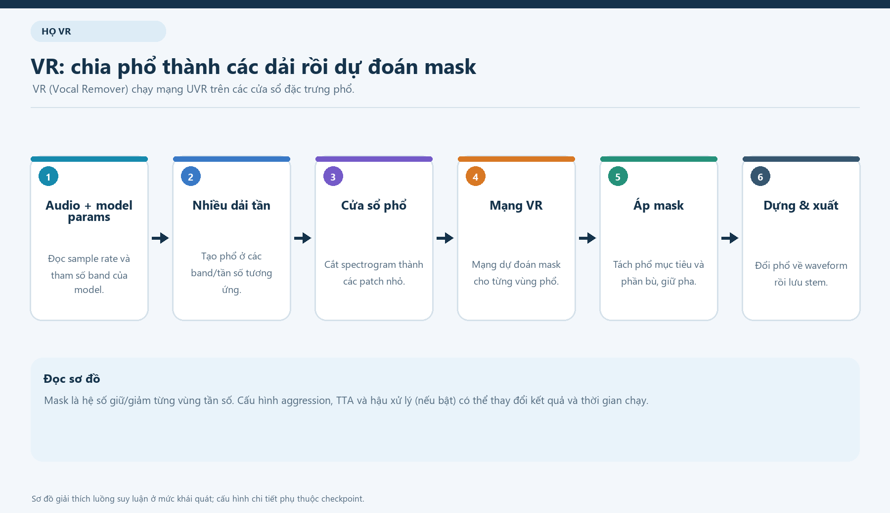
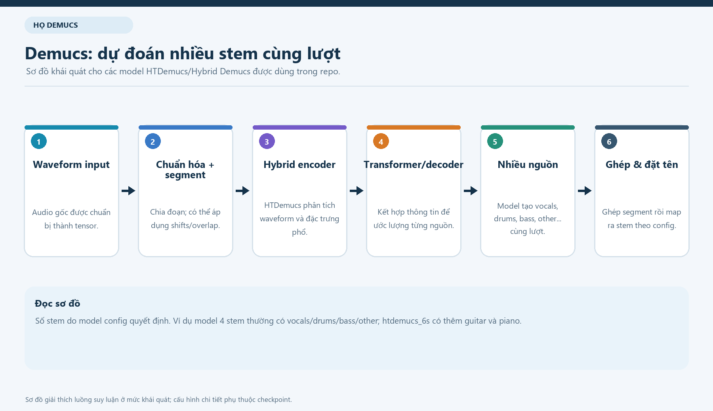
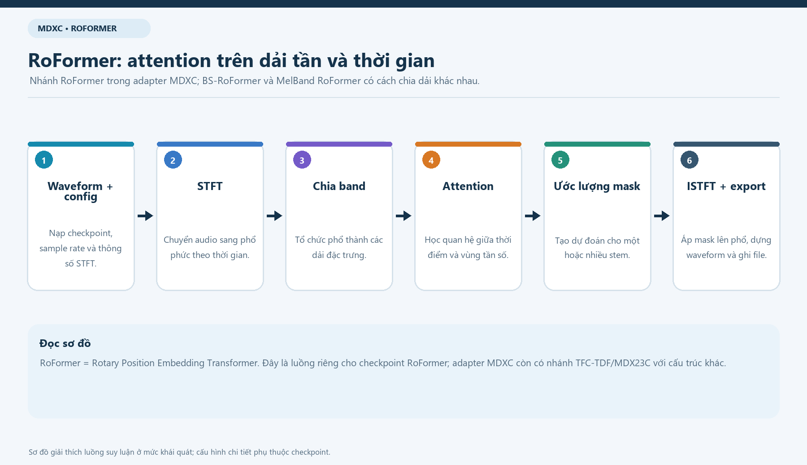
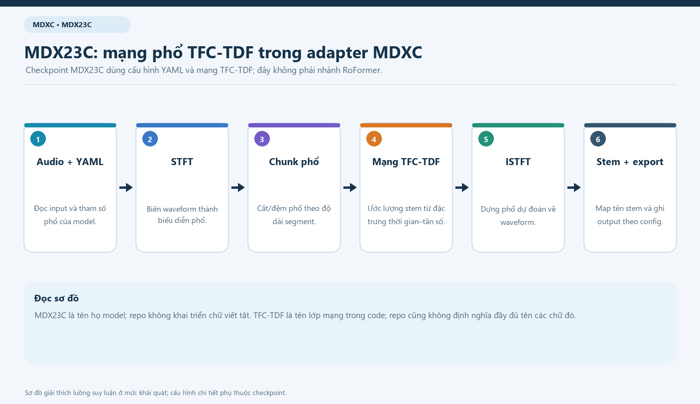
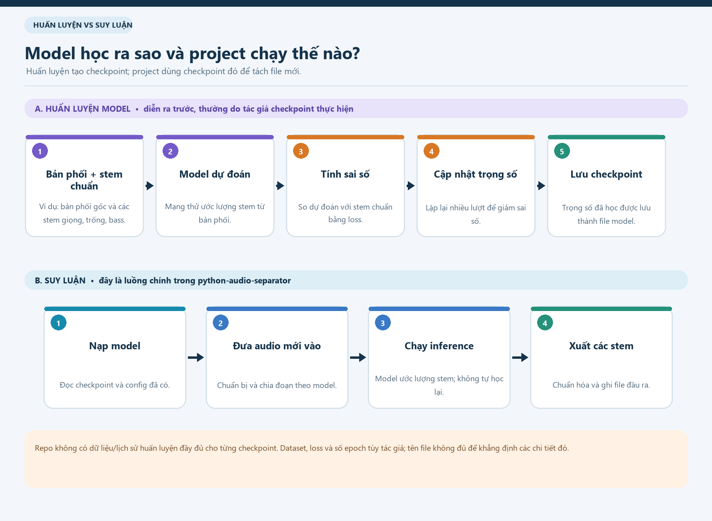
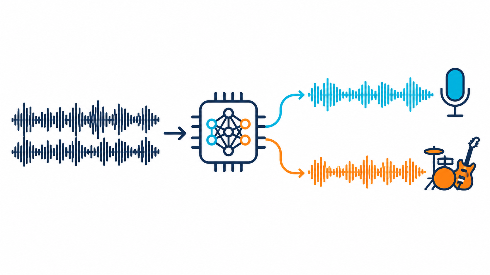

# Sơ đồ luồng hoạt động các mô hình

Trang này tập hợp các ảnh PNG mô tả cách hệ thống xử lý âm thanh và cách từng họ mô hình tạo ra các stem (thành phần âm thanh được tách riêng, ví dụ giọng hát hoặc nhạc cụ).

Các sơ đồ mô tả **suy luận (inference)**: dùng checkpoint (tệp chứa trọng số đã học) có sẵn để tách một file mới. Sơ đồ huấn luyện chỉ minh họa quy trình phổ biến để giúp phân biệt huấn luyện với lúc chạy project; repo không lưu đầy đủ lịch sử huấn luyện cho từng checkpoint.

## Luồng chung của hệ thống

## Luồng theo từng họ mô hình

### MDX

### VR

### Demucs

### MDXC: nhánh RoFormer

### MDXC: nhánh MDX23C / TFC-TDF

Hai sơ đồ MDXC được tách riêng vì adapter này hỗ trợ checkpoint RoFormer và checkpoint MDX23C/TFC-TDF với các luồng xử lý khác nhau.

## Huấn luyện và suy luận khác nhau thế nào?

## Hình minh họa tổng quát

Ảnh này minh họa ý tưởng đưa bản phối vào mô hình để nhận các phần âm thanh tách riêng. Đây là hình khái niệm, không thể hiện các bước xử lý cụ thể trong mã nguồn.

## Tài liệu đọc thêm

- [Tổng quan kỹ thuật hệ thống](TONG_QUAN_KY_THUAT_HE_THONG.md)
- [Giải thích các mô hình trong hệ thống](MO_HINH_TACH_AM_THANH.md)
