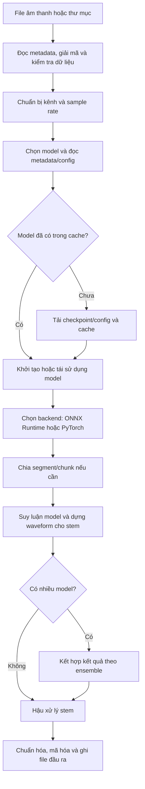

# Tổng quan kỹ thuật hệ thống Audio Separator

Tài liệu này mô tả kiến trúc dựa trên mã nguồn hiện có trong repository và tổng hợp các ghi chú liên quan trong `OldDocs/`. Đây là thư viện Python cung cấp CLI (**Command-Line Interface**, giao diện dòng lệnh) và API (**Application Programming Interface**, giao diện lập trình ứng dụng) để tách âm thanh thành các stem (giọng hát, nhạc nền, trống, bass, guitar, piano, v.v.), có thêm mã cho dịch vụ từ xa.

> Phân biệt thông tin hiện hành với tài liệu lưu trữ: phần kiến trúc và hành vi hiện tại được đối chiếu với mã nguồn/README. Các kế hoạch ngày tháng và số liệu cộng đồng trong `OldDocs/` được ghi rõ là tài liệu tham khảo, không mặc định là cấu hình production hay kết quả đo mới nhất.

> Cập nhật kiến trúc karaoke 0.3.0: tách nhạc và tạo pitch reference thủ công trên local trước khi phát hành bài; lệnh tự chọn GPU/CPU và tận dụng luồng CPU khả dụng. Không có worker nền hoặc gọi model tách lúc phát. FastAPI chỉ chấm điểm; backend sở hữu MongoDB và kho file Oracle. Xem [hướng dẫn chuẩn bị local](KARAOKE_LOCAL_PREPARATION.md), [schema collection](KARAOKE_MONGODB_SCHEMA.md) và [báo cáo triển khai](BAO_CAO_TRIEN_KHAI_KARAOKE.md). Production API vẫn chạy CPU, RAM tối đa 35%; host trước đó là http://158.178.247.33:8000.

## 1. Tóm tắt hệ thống

- Gói Python `audio-separator` cung cấp CLI `audio-separator` và API Python `Separator`.
- Người dùng chọn một model checkpoint. Model có thể được tải tự động và lưu vào thư mục cache.
- Hệ thống chọn bộ xử lý theo loại model: MDX (tên họ kiến trúc, repo không khai triển thành cụm từ), VR (**Vocal Remover**, họ kiến trúc tách âm UVR), Demucs (tên riêng của họ tách nguồn) hoặc MDXC/RoFormer (**Rotary Position Embedding Transformer**, nhãn adapter và họ Transformer dùng mã hóa vị trí xoay).
- Model suy luận trên âm thanh đầu vào để tạo một hoặc nhiều stem. Có thể kết hợp nhiều model bằng ensemble.
- Kết quả được chuẩn hóa theo cấu hình rồi ghi thành các file âm thanh riêng.
- Repository còn giữ client và mã server API từ xa cũ (Modal và Cloud Run) để tham khảo; hướng triển khai mới dùng FastAPI độc lập trên máy chủ của bạn.

Điểm quan trọng: đây không phải hệ thống chỉ sử dụng một mô hình AI (**Artificial Intelligence**, trí tuệ nhân tạo). Mặc định CLI và lớp `Separator` hiện chọn BS-RoFormer (**Band-Split RoPE Transformer**, Transformer chia dải tần dùng mã hóa vị trí xoay) checkpoint `model_bs_roformer_ep_317_sdr_12.9755.ckpt`, nhưng người dùng có thể chọn model khác trong danh mục.

## 2. Kiến trúc model

| Họ model | Tệp thường gặp | Cách chạy trong hệ thống | Công dụng thường gặp |
|---|---|---|---|
| **MDX** (tên họ model UVR; repository không khai triển chính thức chữ viết tắt này) | `.onnx` | Chạy bằng ONNX Runtime; ONNX (**Open Neural Network Exchange**, định dạng mở để biểu diễn và trao đổi model máy học) đóng gói mạng để chạy bằng runtime tương thích. Model xử lý theo cửa sổ/segment và dùng phép biến đổi phổ, sau đó dựng lại waveform. | Tách giọng/nhạc nền; có model cho tác vụ cụ thể. |
| **VR** (**Vocal Remover**, tên họ kiến trúc UVR) | `.pth` | Mạng UVR (**Ultimate Vocal Remover**, tên ứng dụng/hệ sinh thái tách âm) chạy qua PyTorch, xử lý đặc trưng phổ theo cửa sổ và cấu hình model. | Tách giọng, nhạc cụ hoặc stem theo model. |
| **Demucs** (tên riêng của họ model tách nguồn, không phải chữ viết tắt) | `.yaml` | YAML (**YAML Ain't Markup Language**, định dạng văn bản dễ đọc dùng để lưu cấu hình) mô tả model. Họ HTDemucs (**Hybrid Transformer Demucs**, biến thể Demucs kết hợp waveform và phổ) chạy trong PyTorch. | Thường tách 4 stem: vocals, drums, bass, other; một số model tách thêm guitar/piano. |
| **MDXC** (nhãn loại model trong code; repository không cung cấp khai triển acronym) / **RoFormer** (**Rotary Position Embedding Transformer**, Transformer dùng mã hóa vị trí xoay) | `.ckpt` kèm YAML config | Model PyTorch gồm BS-RoFormer (**Band-Split RoPE Transformer**, RoFormer chia dải tần; RoPE là **Rotary Position Embedding**, mã hóa vị trí xoay) và MelBand RoFormer. Biểu diễn thời gian–tần số được chia thành dải; attention (cơ chế chú ý) học quan hệ giữa các vùng để ước lượng stem. | Tách giọng, nhạc nền, karaoke, khử vang/khử nhiễu và các tác vụ theo checkpoint. |

### Mô hình tách âm thanh hoạt động ra sao?

Mỗi checkpoint được huấn luyện cho một tác vụ và stem mục tiêu cụ thể. Khi suy luận, mạng nhận bản phối gốc, tìm các mẫu âm thanh có khả năng thuộc stem mục tiêu rồi tạo ước lượng âm thanh riêng. Các mô hình phổ thường ước lượng đặc trưng hoặc mask (mặt nạ giữ/giảm vùng tần số) trong miền tần số; một số kiến trúc làm việc trực tiếp/hỗn hợp trên waveform (dạng sóng). Hệ thống chuyển kết quả về dạng sóng và xuất các stem.

Chi tiết nội bộ không giống nhau giữa các kiến trúc. MDX dùng model ONNX; VR dựa trên kiến trúc UVR; Demucs có nhánh xử lý waveform và cấu hình hybrid; RoFormer dùng các khối attention trên biểu diễn thời gian–tần số. Vì vậy sơ đồ dưới đây là luồng chung, không khẳng định mọi model dùng cùng một phép biến đổi hay cùng một kiểu mask.



### Luồng xử lý chi tiết

1. **Nhận đầu vào:** CLI/API nhận một file, danh sách file hoặc thư mục. Audio được đọc, kiểm tra số mẫu hợp lệ và giá trị hữu hạn; audio mono được chuyển sang dạng hai kênh cho các đường xử lý cần stereo.
2. **Chuẩn bị audio:** đầu vào được giải mã, chuyển về sample rate được cấu hình (mặc định 44.1 kHz) và lưu metadata subtype/bit depth nếu backend đọc được.
3. **Chọn model:** `models.json`, YAML đi kèm, model metadata và hash hỗ trợ nhận diện kiến trúc, stem mục tiêu, cấu hình inference và tên file cần tải. Model được tải tự động nếu chưa có trong cache.
4. **Chọn backend/thiết bị:** model MDX dùng ONNX Runtime; các họ PyTorch dùng thiết bị mà môi trường hỗ trợ (CPU/CUDA/MPS; DirectML có giới hạn riêng).
5. **Suy luận:** model xử lý các cửa sổ/segment. Với file dài có thể bật `chunk_duration` để tách thành nhiều chunk rồi ghép các stem tương ứng.
6. **Ensemble tùy chọn:** khi có nhiều model, mỗi model được chạy lần lượt trên cùng đầu vào; sau đó kết quả stem tương ứng được kết hợp bằng thuật toán đã chọn. Đây không mặc định là chạy song song.
7. **Hậu xử lý và ghi file:** có thể chọn một stem, áp dụng normalization/amplification, đảo stem theo phổ trong các trường hợp hỗ trợ, rồi ghi output bằng pydub/FFmpeg hoặc soundfile. Tên stem chủ yếu dựa trên metadata model.

## 3. Ensemble và lựa chọn model

Ensemble kết hợp dự đoán của nhiều model cho cùng một stem. Các thuật toán hiện có gồm `avg_wave`, `median_wave`, `min_wave`, `max_wave`, `avg_fft`, `median_fft`, `min_fft`, `max_fft`, `uvr_max_spec`, `uvr_min_spec` và `ensemble_wav`. FFT (**Fast Fourier Transform**, biến đổi Fourier nhanh) là phép tính thành phần tần số; cách kết hợp khác nhau có thể làm thay đổi độ đầy, độ sạch, nhiễu và âm lọt.

Repository hiện có các preset trong [`audio_separator/ensemble_presets.json`](../audio_separator/ensemble_presets.json), gồm:

- Nhạc nền: `instrumental_clean`, `instrumental_full`, `instrumental_balanced`, `instrumental_low_resource`.
- Giọng hát: `vocal_balanced`, `vocal_clean`, `vocal_full`, `vocal_rvc` (preset hướng tới vocals dùng cho RVC — **Retrieval-Based Voice Conversion**, chuyển đổi giọng dựa trên truy xuất đặc trưng).
- Karaoke: `karaoke`.

Các preset này là cấu hình lựa chọn model/thuật toán dựa trên tổng hợp cộng đồng trong tài liệu Deton24. Các con số trong mô tả preset là số tham chiếu của cộng đồng, không phải cam kết chất lượng cho mọi bài hát.

## 4. Chỉ số và thông tin hệ thống ghi nhận

Nên phân biệt **điểm benchmark sẵn có của model** với **thông tin được ghi trong một lượt chạy**. SDR (**Signal-to-Distortion Ratio**, tỷ lệ tín hiệu trên méo), bleedless và fullness không được tính mới cho từng file người dùng trong luồng inference.

### 4.1 Điểm benchmark trong danh mục model

[`audio_separator/models-scores.json`](../audio_separator/models-scores.json) lưu benchmark (đánh giá trên bộ mẫu tham chiếu) theo model, track và stem. Các chỉ số được viết tắt như sau:

| Chỉ số | Ý nghĩa khái quát |
|---|---|
| **SDR** (**Signal-to-Distortion Ratio**, tỷ lệ tín hiệu trên méo) | Đo chất lượng tổng thể của stem so với stem tham chiếu. |
| **SIR** (**Source-to-Interference Ratio**, tỷ lệ nguồn trên nhiễu lẫn) | Đo mức âm thanh từ nguồn/stem khác bị lẫn vào mục tiêu. |
| **SAR** (**Sources-to-Artifacts Ratio**, tỷ lệ nguồn trên âm giả) | Đo mức âm thanh giả/méo do quá trình tách tạo ra. |
| **ISR** (**Image-to-Spatial Distortion Ratio**, tỷ lệ sai lệch không gian) | Đo sai lệch không gian/ảnh âm thanh so với tham chiếu. |

CLI (**Command-Line Interface**, giao diện dòng lệnh) `--list_models` hiển thị tên kiến trúc, stem và SDR khi có dữ liệu. Các điểm này so sánh model trên bộ track benchmark; kết quả của một bài cụ thể có thể khác. Giá trị cao hơn thường tốt hơn trong đúng phép đo, nhưng không thay thế nghe thử.

### 4.2 Bleedless và fullness trong tài liệu cộng đồng

Hướng dẫn Deton24 và mô tả preset dùng thêm hai khái niệm:

- **Bleedless:** mức sạch khỏi âm thanh của stem khác. Tăng độ sạch có thể làm stem nghe đục hơn hoặc bỏ sót nhạc cụ/chi tiết nhỏ.
- **Fullness:** mức độ nội dung của stem mục tiêu được giữ lại. Stem đầy hơn có thể đồng thời có nhiều âm lọt hoặc nhiễu hơn.

Đây là các số/thứ hạng tham khảo do tài liệu cộng đồng nêu; chúng không phải trường benchmark chuẩn hóa trong `models-scores.json` và không được tính lại cho từng lần inference. Thực tế thường có đánh đổi giữa độ sạch và độ đầy.

### 4.3 Thông tin ghi trong lúc chạy cục bộ

Log của hệ thống có thể ghi:

- Phiên bản package, Python/PyTorch, hệ điều hành, thiết bị và backend tăng tốc sẵn có (`--env_info`).
- Model được chọn, loại kiến trúc, tên thân thiện, model/config được tải và thời gian tải model.
- Thời lượng audio đầu vào, subtype/bit depth nhận diện được, sample rate và kích thước mảng ở mức log phù hợp.
- Thời gian tách audio, chunk đang xử lý, cảnh báo/lỗi tải model, suy luận hoặc ghi file.
- Thông số cấu hình như định dạng output, sample rate, normalization, số segment/chunk và tùy chọn ensemble.

Đây chủ yếu là log phục vụ chẩn đoán và hiển thị tiến trình; repository không có mặc định một dashboard telemetry lưu chất lượng tách từng bài hay số liệu sử dụng GPU cho mỗi inference cục bộ.

### 4.4 Trạng thái job của API từ xa

Trong đường Cloud Run, thông tin job được lưu qua Firestore; file đầu ra được tải lên GCS. Job có các trường như `status`, `progress`, `error`, `models_used`, `total_models`, `current_model_index`, `files`, tên file gốc, `instance_id`, `created_at` và `updated_at`. Trạng thái phổ biến gồm `submitted`, `processing`, `completed`, `error` và `not_found`.

`progress` là phần trăm tiến trình do các bước trong server cập nhật để client polling; không phải số đo chính xác thời gian còn lại, mức tải GPU hay phần trăm FLOPs đã hoàn thành. Các timestamp là dấu thời gian cập nhật job, không phải bộ phân tích hiệu năng inference đầy đủ.

### 4.5 Chỉ số trong bộ kiểm thử

Một số script kiểm thử tính correlation (mức tương quan) với waveform tham chiếu, RMS (**Root Mean Square**, căn bậc hai của trung bình bình phương mẫu) để phát hiện output gần im lặng, peak hoặc thời gian suy luận. Đây là tiêu chí xác minh đầu ra/hiệu năng trong kịch bản kiểm thử, không phải bộ chỉ số sản phẩm tự động chạy trên mọi file người dùng.

## 5. Thiết bị và khả năng tăng tốc

Trong bảng dưới đây, CPU (**Central Processing Unit**, bộ xử lý trung tâm) là bộ xử lý chính; GPU (**Graphics Processing Unit**, bộ xử lý đồ họa) là phần cứng tăng tốc. CUDA (**Compute Unified Device Architecture**, nền tảng tính toán GPU của NVIDIA), MPS (**Metal Performance Shaders**, backend tính toán GPU trên Apple) và DirectML (**Direct Machine Learning**, giao diện tăng tốc máy học trên Windows) là các đường chạy khác nhau. Core ML là tên framework máy học của Apple, không phải từ viết tắt cần khai triển.

Theo README hiện tại:

| Nền tảng/backend | Tình trạng khái quát |
|---|---|
| CPU | Chạy được các họ model; tốc độ phụ thuộc model và phần cứng. |
| CUDA | Tăng tốc model PyTorch và ONNX khi các runtime/provider tương ứng được cài đúng. |
| Apple Silicon MPS/Core ML | Có đường hỗ trợ cho các model/runtime tương thích. |
| Windows DirectML | Tùy chọn thử nghiệm. MDX và VR có đường tăng tốc; MDXC/RoFormer tự chạy CPU theo mặc định do giới hạn bộ cấp phát bộ nhớ của `torch-directml`; Demucs chưa hỗ trợ do thiếu toán tử LSTM (**Long Short-Term Memory**, mạng nhớ ngắn-dài hạn) cần thiết. |

Thiết bị thực tế được chọn phụ thuộc cài đặt PyTorch/ONNX Runtime, model và cờ runtime. Có thể dùng `audio-separator --env_info` để xem thông tin môi trường. Bảng tương thích có thể thay đổi; README là tài liệu nên kiểm tra trước khi cấu hình máy mới.

## 6. Định dạng âm thanh và độ sâu bit

Hai tài liệu [`BIT_DEPTH_PRESERVATION.md`](../OldDocs/BIT_DEPTH_PRESERVATION.md) và [`BIT_DEPTH_IMPLEMENTATION_SUMMARY.md`](../OldDocs/BIT_DEPTH_IMPLEMENTATION_SUMMARY.md) ghi lại việc bảo toàn độ sâu bit đầu vào khi xuất WAV (**Waveform Audio File Format**, định dạng file âm thanh dạng sóng) hoặc FLAC (**Free Lossless Audio Codec**, codec âm thanh nén không mất dữ liệu): nhận diện subtype PCM (**Pulse-Code Modulation**, cách mã hóa âm thanh thành mẫu số) bằng soundfile, rồi ghi 16/24/32-bit tương ứng khi backend/codec hỗ trợ. Nếu không xác định được metadata, đường xử lý có thể dùng mặc định 16-bit. Định dạng mất dữ liệu và khả năng codec chịu ảnh hưởng từ FFmpeg/pydub.

Độ sâu bit nói về độ phân giải số của file xuất; nó không phải chỉ số chất lượng tách AI. CLI mặc định xuất FLAC, trong khi lớp `Separator` khi khởi tạo trực tiếp có mặc định WAV; có thể đổi bằng tham số `output_format`.

## 7. Tổng hợp tài liệu trong `OldDocs/`

### `deton24-model-mapping-and-ensemble-guide.md`

Hướng dẫn ánh xạ biệt danh model trong cộng đồng sang tên checkpoint trong audio-separator, giải thích SDR/bleedless/fullness, các thuật toán ensemble và đề xuất preset. Tài liệu cũng tổng hợp kỹ thuật **phase fix**: lấy biên độ từ đầu ra model nhạc nền và thông tin pha từ đầu ra instrumental của model huấn luyện cho giọng hát.

Hãy xem các gợi ý model/preset trong hướng dẫn là kiến thức cộng đồng. Một số tên checkpoint trong các bảng có thể không có trong danh mục hiện tại; kiểm tra [`audio_separator/models.json`](../audio_separator/models.json) và `--list_models` trước khi dùng. Phase fix được bàn trong tài liệu, nhưng không thấy một triển khai phase-fixer độc lập trong mã nguồn Python hiện tại.

### `deton24-audio-separation-info-2026-03-15.md` và `deton24-audio-separation-info-2026-03-15-vi.md`

Hai bản ghi nghiên cứu lớn (khoảng 14 nghìn dòng mỗi bản) tập hợp ghi chú cộng đồng về model UVR, tách stem, mastering, karaoke, nhạc cụ, khử vang/nhiễu, model benchmark, ensemble và kinh nghiệm tinh chỉnh. Bản `-vi.md` là bản tiếng Việt tương ứng. Đây là nguồn tham khảo rộng, không phải đặc tả chính thức của package; các gợi ý gắn với model/dịch vụ bên ngoài có thể không áp dụng trực tiếp ở đây.

### `2026-03-22-modal-to-gcp-migration-plan.md`

Kế hoạch lịch sử chuyển API từ Modal sang GPU Cloud Run trên GCP (**Google Cloud Platform**, nền tảng dịch vụ đám mây của Google), cân nhắc GPU L4, lưu model/output trên GCS (**Google Cloud Storage**, dịch vụ lưu trữ file của Google Cloud), theo dõi trạng thái qua API và sử dụng ensemble preset. Mã repository hiện có `deploy_cloudrun.py`, Firestore job store và GCS output store, nên đã có phần triển khai Cloud Run trong source. Tuy nhiên tài liệu là kế hoạch có checklist/ước tính cũ; chỉ riêng sự hiện diện của source không xác nhận dịch vụ đang được deploy hay các mức chi phí/thời gian trong tài liệu còn đúng.

### `2026-07-19-roformer-windows-directml-plan.md`

Tài liệu ghi nhận lỗi tương thích RoFormer với DirectML, các toán tử tensor phức và vấn đề tải model/bộ nhớ, rồi đưa ra kế hoạch xử lý và kiểm thử. Để biết trạng thái hiện tại, ưu tiên bảng DirectML trong README và code hiện hành: RoFormer/MDXC chạy CPU tự động theo mặc định trên DirectML do giới hạn allocator; có biến môi trường để thử ép chạy DML, nhưng có thể hết bộ nhớ. Demucs không được hỗ trợ trên DirectML.

### `CI-GPU-RUNNERS.md`

Mô tả hạ tầng CI GPU dùng runner GCE tạm thời, mỗi VM xử lý một job rồi bị xóa, kèm hướng dẫn điều phối và xử lý sự cố. Tài liệu nói rõ các thành phần runner nằm trong repo `karaoke-gen`, không phải trong repository audio-separator này. Nội dung hữu ích để hiểu CI tích hợp, nhưng một số trạng thái/chi phí/hướng dẫn phụ thuộc hạ tầng bên ngoài và có thể thay đổi.

### Hai tài liệu bảo toàn bit depth

`BIT_DEPTH_PRESERVATION.md` mô tả chi tiết phát hiện subtype, cách ghi output và các kịch bản xác minh; `BIT_DEPTH_IMPLEMENTATION_SUMMARY.md` là bản tóm tắt issue/triển khai/kết quả. Cả hai nói về cùng một tính năng nên có phần lặp lại.

## 8. Các file mã nguồn nên đọc

| File | Vai trò |
|---|---|
| [`README.md`](../README.md) | Cài đặt, CLI, API, backend và ma trận tương thích. |
| [`pyproject.toml`](../pyproject.toml) | Dependency, extra CPU/GPU/DirectML và entry point CLI. |
| [`audio_separator/utils/cli.py`](../audio_separator/utils/cli.py) | Khai báo và kết nối tham số dòng lệnh. |
| [`audio_separator/separator/separator.py`](../audio_separator/separator/separator.py) | Điều phối model, tải model, tách file, chunking và ensemble. |
| [`audio_separator/separator/common_separator.py`](../audio_separator/separator/common_separator.py) | Logic chung đọc/chuẩn bị audio, hậu xử lý và ghi stem. |
| [`audio_separator/separator/architectures/`](../audio_separator/separator/architectures/) | Adapter theo từng họ MDX, VR, Demucs và MDXC. |
| [`audio_separator/models.json`](../audio_separator/models.json) | Danh mục model và ánh xạ file checkpoint/config; JSON (**JavaScript Object Notation**, định dạng dữ liệu văn bản có cấu trúc). |
| [`audio_separator/models-scores.json`](../audio_separator/models-scores.json) | Điểm tham chiếu theo track/stem của model. |
| [`audio_separator/model-data.json`](../audio_separator/model-data.json) | Metadata model dùng trong quá trình nhận diện/cấu hình. |
| [`audio_separator/ensemble_presets.json`](../audio_separator/ensemble_presets.json) | Cấu hình preset ensemble. |
| [`audio_separator/remote/`](../audio_separator/remote/) | Client, CLI và mã server API từ xa cũ để tham khảo; không phải dịch vụ karaoke mới. |

## 9. Cách chạy nhanh

Cần Python từ 3.10 trở lên (trừ 3.14.1 theo metadata package) và FFmpeg cho các đường đọc/ghi dựa trên pydub. Cách cài phụ thuộc CPU/GPU và nền tảng; xem phần Installation trong README để cài đúng runtime.

```bash
# Tách vocals và instrumental bằng model mặc định
audio-separator input.wav --output_dir separated

# Chọn model cụ thể
audio-separator input.wav \
  --model_filename model_bs_roformer_ep_317_sdr_12.9755.ckpt \
  --output_dir separated

# Xem và lọc danh mục model
audio-separator --list_models --list_filter vocals

# Dùng preset ensemble có sẵn
audio-separator input.wav --ensemble_preset instrumental_clean
```

Model được tải tự động ở lần chạy đầu. Thư mục cache mặc định của CLI là `/tmp/audio-separator-models/`; có thể đổi bằng `--model_file_dir`. Lệnh dùng dấu gạch chéo trong ví dụ hoạt động trên shell kiểu Unix; trên PowerShell có thể viết các tham số cùng một dòng hoặc dùng dấu backtick để xuống dòng.

Ví dụ dùng trong Python:

```python
from audio_separator.separator import Separator

separator = Separator(output_dir="separated")
separator.load_model("model_bs_roformer_ep_317_sdr_12.9755.ckpt")
output_paths = separator.separate("input.wav")
print(output_paths)
```

## 10. Lưu ý khi đọc điểm và tài liệu

- Điểm benchmark của model giúp sàng lọc, còn âm thanh cần nghe thử theo bài và mục đích sử dụng.
- Đừng nhầm tên có `sdr_...` trong tên checkpoint với SDR được đo cho file mới.
- Preset là lựa chọn mẫu; thay model/thuật toán có thể đổi cân bằng giữa độ sạch, độ đầy, artifact, tốc độ và bộ nhớ.
- File kế hoạch trong `OldDocs/` ghi trạng thái tại thời điểm soạn. Khi có khác biệt, dùng code hiện tại và README để mô tả hành vi đang có.
- Độ sâu bit đầu ra, progress API, thời gian xử lý và SDR là các loại thông tin khác nhau; không nên diễn giải chúng như một thước đo duy nhất về chất lượng.

## 11. Bảng thuật ngữ kỹ thuật

| Thuật ngữ viết tắt | Tên đầy đủ và giải thích |
|---|---|
| **AI** | **Artificial Intelligence** — trí tuệ nhân tạo; trong dự án là các mạng máy học tách âm. |
| **CLI** | **Command-Line Interface** — giao diện dòng lệnh, nơi nhập lệnh để chạy chương trình. |
| **API** | **Application Programming Interface** — giao diện lập trình ứng dụng, cho phép code khác gọi chức năng của package/server. |
| **ONNX** | **Open Neural Network Exchange** — định dạng mở để biểu diễn/trao đổi model; file `.onnx` được chạy bằng ONNX Runtime. |
| **YAML** | **YAML Ain't Markup Language** — định dạng văn bản dễ đọc để lưu cấu hình model. |
| **JSON** | **JavaScript Object Notation** — định dạng văn bản có cấu trúc dùng cho danh mục và metadata. |
| **UVR** | **Ultimate Vocal Remover** — tên ứng dụng/hệ sinh thái tách âm mà nhiều model trong package tương thích. |
| **VR** | **Vocal Remover** — tên họ kiến trúc UVR; ở đây không có nghĩa là Virtual Reality. |
| **MDX / MDX23C / MDXC** | Tên họ/nhãn model được dùng trong repository. Code không ghi một khai triển chính thức cho các chữ này, nên không nên tự đoán expanded name. |
| **Demucs** | Tên riêng của họ model tách nguồn, không phải chữ viết tắt. **HTDemucs** là biến thể **Hybrid Transformer Demucs**, kết hợp thông tin waveform và phổ. |
| **RoFormer** | **Rotary Position Embedding Transformer** — họ Transformer sử dụng mã hóa vị trí xoay. |
| **RoPE** | **Rotary Position Embedding** — cách đưa vị trí vào Transformer bằng phép xoay trên biểu diễn. |
| **BS-RoFormer** | **Band-Split RoPE Transformer** — RoFormer chia phổ thành các dải tần để xử lý bài toán tách nguồn. |
| **STFT** | **Short-Time Fourier Transform** — biến đổi Fourier ngắn hạn, chuyển các khung waveform thành phổ theo thời gian. |
| **ISTFT** | **Inverse Short-Time Fourier Transform** — phép biến đổi ngược để dựng waveform từ phổ đã xử lý. |
| **FFT** | **Fast Fourier Transform** — thuật toán tính thành phần tần số của tín hiệu. |
| **SDR** | **Signal-to-Distortion Ratio** — tỷ lệ tín hiệu trên méo; điểm tổng quát so với âm thanh tham chiếu. |
| **SIR** | **Source-to-Interference Ratio** — tỷ lệ nguồn trên nhiễu lẫn; phản ánh âm từ stem khác lọt vào. |
| **SAR** | **Sources-to-Artifacts Ratio** — tỷ lệ nguồn trên artifact; phản ánh âm méo/lạ do tách tạo ra. |
| **ISR** | **Image-to-Spatial Distortion Ratio** — tỷ lệ sai lệch không gian của output so với tham chiếu. |
| **BVE** | **Backing Vocal Extraction** — tách bè/giọng hát phụ; đây là nhãn tác vụ trong tên model UVR-BVE. |
| **RVC** | **Retrieval-Based Voice Conversion** — chuyển đổi giọng dựa trên truy xuất đặc trưng giọng; preset `vocal_rvc` hướng output vocals tới dữ liệu loại này. |
| **CPU** | **Central Processing Unit** — bộ xử lý trung tâm của máy tính. |
| **GPU** | **Graphics Processing Unit** — bộ xử lý đồ họa, thường dùng để tăng tốc inference. |
| **CUDA** | **Compute Unified Device Architecture** — nền tảng tính toán GPU của NVIDIA. |
| **MPS** | **Metal Performance Shaders** — backend tính toán GPU của Apple dùng trong PyTorch trên thiết bị tương thích. |
| **DirectML** | **Direct Machine Learning** — giao diện tăng tốc máy học trên phần cứng tương thích Windows/DirectX. |
| **DML** | Cách viết tắt của DirectML trong một số tên cờ/biến môi trường của code. |
| **Core ML** | Tên framework máy học của Apple; đây là tên sản phẩm, không phải acronym cần khai triển. |
| **LSTM** | **Long Short-Term Memory** — dạng mạng hồi tiếp có cơ chế ghi nhớ thông tin theo chuỗi. |
| **CI** | **Continuous Integration** — tích hợp liên tục; tự động chạy kiểm tra khi cập nhật code. |
| **GCE / GCP / GCS** | **Google Compute Engine** (máy ảo), **Google Cloud Platform** (nền tảng đám mây), **Google Cloud Storage** (lưu trữ file). |
| **VM** | **Virtual Machine** — máy ảo chạy như một máy tính độc lập. |
| **RAM / VRAM** | **Random Access Memory** (bộ nhớ hệ thống) / **Video Random Access Memory** (bộ nhớ GPU). |
| **RMS** | **Root Mean Square** — căn bậc hai của trung bình bình phương mẫu; thường dùng để đo mức năng lượng âm thanh. |
| **PCM** | **Pulse-Code Modulation** — cách mã hóa tín hiệu âm thanh thành các mẫu số. |
| **WAV** | **Waveform Audio File Format** — định dạng file âm thanh dạng sóng. |
| **FLAC** | **Free Lossless Audio Codec** — codec âm thanh nén không mất dữ liệu. |
| **TTA** | **Test-Time Augmentation** — biến đổi input trong lúc inference rồi tổng hợp dự đoán; có thể tăng thời gian chạy. |
| **FP16** | **16-bit floating-point** — số dấu phẩy động 16-bit, có thể giảm bộ nhớ/tăng tốc trên tổ hợp model và thiết bị được hỗ trợ. |
| **FT / HQ / INST / NET** | Hậu tố trong tên model: **fine-tuned** (được tinh chỉnh tiếp), **High Quality** (chất lượng cao theo cách đặt tên tác giả), **instrumental** (nhạc nền), **network** (mạng). Ý nghĩa cụ thể vẫn phụ thuộc tác giả checkpoint. |
| **FV / SYHFT / SW** | Mã dòng model hoặc hậu tố tác giả. Repository không định nghĩa đầy đủ các chữ này; cần giữ nguyên tên model và xem metadata/ghi chú của tác giả thay vì tự diễn giải. |
| **V1 / V2 / V3…** | Nhãn phiên bản model, không phải thước đo chất lượng và cũng không bảo đảm bản mới hơn tốt hơn cho mọi bài. |
| **Model / checkpoint / config** | Model là mạng; checkpoint là file trọng số đã học; config là tham số khớp với checkpoint. |
| **Inference / suy luận** | Chạy model đã huấn luyện trên audio mới; đây không phải bước cập nhật trọng số. |
| **Stem** | Một phần âm thanh riêng như `Vocals`, `Instrumental`, `Drums`, `Bass`, `Guitar` hoặc `Piano`. |
| **Waveform / spectrogram** | Waveform là biên độ theo thời gian; spectrogram là biểu diễn cường độ tần số theo thời gian. |
| **Sample rate / bit depth** | Sample rate là số mẫu mỗi giây (Hz); bit depth là độ phân giải số của mỗi mẫu khi lưu file. |
| **Segment / chunk / overlap / batch size** | Segment là cửa sổ suy luận; chunk là phần của file dài; overlap là phần cửa sổ chồng nhau; batch size là số phần xử lý cùng lượt. |
| **Ensemble / preset** | Ensemble kết hợp dự đoán nhiều model; preset là cấu hình model và thuật toán kết hợp đã đặt sẵn. |
| **Bleedless / fullness** | Nhãn/chỉ số cộng đồng về độ ít âm lọt và độ giữ nội dung; thường có đánh đổi và không được tính mới cho từng lượt chạy. |
| **Phase fix / phase swap** | Kỹ thuật kết hợp biên độ của một output với pha từ output khác; tài liệu cộng đồng có mô tả, còn package hiện không có bộ phase-fixer độc lập. |
| **Job status / progress** | Trạng thái và phần trăm cập nhật từ API; progress là mốc quy ước, không phải dự báo chính xác thời gian còn lại. |

## 12. Danh mục các model có trong repository

Danh sách dưới đây được tổng hợp từ `audio_separator/models.json` và các model Demucs được README nêu. Các biến thể cùng một họ thường khác dữ liệu huấn luyện hoặc cách tinh chỉnh; số phiên bản/tên tác giả không tự nó chứng minh model nào tốt hơn. Stem thực tế hãy kiểm tra bằng `audio-separator --list_models` vì metadata của checkpoint mới là nguồn quyết định.

### 12.1 Model MDX, MDX23C và VR

| Checkpoint | Dùng để làm gì |
|---|---|
| `UVR-MDX-NET-Inst_HQ_5.onnx` | Model MDX tách nhạc nền; thường dùng cho instrumental/karaoke. |
| `MDX23C-De-Reverb-aufr33-jarredou.ckpt` | Model MDX23C chuyên giảm vang. |
| `MDX23C-DrumSep-aufr33-jarredou.ckpt` | Model MDX23C chuyên tách trống. |
| `UVR-De-Reverb-aufr33-jarredou.pth` | Model VR chuyên giảm vang. |
| `UVR-BVE-4B_SN-44100-2.pth` | Model VR thuộc nhóm BVE (backing-vocal extraction), dùng cho tách bè/giọng phụ theo metadata của model. |

### 12.2 Model Demucs

Các model này dùng cấu hình YAML; chúng không nằm trong danh sách checkpoint tải về của `models.json` như các nhóm trên.

| Cấu hình | Dùng để làm gì |
|---|---|
| `htdemucs.yaml` | Demucs v4 hybrid tách bốn stem: vocals, drums, bass và other. |
| `htdemucs_ft.yaml` | Bản fine-tuned của HTDemucs, tách bốn stem vocals/drums/bass/other. |
| `htdemucs_mmi.yaml` | Biến thể Demucs v4 khác, tách bốn stem vocals/drums/bass/other. |
| `htdemucs_6s.yaml` | Model sáu stem: vocals, drums, bass, guitar, piano và other. |

### 12.3 Model MDXC/RoFormer: karaoke và tách giọng

Các checkpoint karaoke chủ yếu nhắm đến việc loại giọng chính để tạo nhạc nền. Checkpoint vocals giữ lại giọng hát; các biến thể `bleedless` nhắm tới độ sạch cao hơn, còn `fullness` nhắm tới việc giữ lại nhiều chi tiết hơn.

| Checkpoint | Giải thích |
|---|---|
| `mel_band_roformer_karaoke_aufr33_viperx_sdr_10.1956.ckpt` | MelBand RoFormer karaoke của aufr33/Viperx. |
| `mel_band_roformer_karaoke_gabox.ckpt` | MelBand RoFormer karaoke của Gabox, bản đầu. |
| `mel_band_roformer_karaoke_gabox_v2.ckpt` | Phiên bản karaoke V2 của Gabox. |
| `mel_band_roformer_karaoke_becruily.ckpt` | MelBand RoFormer karaoke của becruily. |
| `bs_roformer_karaoke_frazer_becruily.ckpt` | BS-RoFormer karaoke của frazer/becruily. |
| `bs_roformer_karaoke_anvuew.ckpt` | BS-RoFormer karaoke của anvuew. |
| `vocals_mel_band_roformer.ckpt` | MelBand RoFormer tách vocals của Kimberley Jensen. |
| `mel_band_roformer_kim_ft_unwa.ckpt` | Bản fine-tune của model Kim cho vocals. |
| `mel_band_roformer_kim_ft2_unwa.ckpt` | Fine-tune Kim FT2 cho vocals. |
| `mel_band_roformer_kim_ft2_bleedless_unwa.ckpt` | Biến thể FT2 được cộng đồng gắn nhãn giảm lẫn âm. |
| `mel_band_roformer_kim_ft3_unwa.ckpt` | Fine-tune Kim FT3 cho vocals. |
| `bs_roformer_vocals_revive_unwa.ckpt` | BS-RoFormer Revive cho vocals. |
| `bs_roformer_vocals_revive_v2_unwa.ckpt` | Revive V2; hướng tới vocals sạch hơn theo ghi chú cộng đồng. |
| `bs_roformer_vocals_revive_v3e_unwa.ckpt` | Revive V3e; cộng đồng ghi nhận thiên về giữ vocal đầy hơn. |
| `mel_band_roformer_vocals_becruily.ckpt` | MelBand RoFormer vocals của becruily. |
| `mel_band_roformer_vocal_fullness_aname.ckpt` | Model vocals của Aname được gắn nhãn fullness. |
| `bs_roformer_vocals_gabox.ckpt` | BS-RoFormer vocals của Gabox. |
| `mel_band_roformer_vocals_gabox.ckpt` | MelBand RoFormer vocals của Gabox. |
| `mel_band_roformer_vocals_v2_gabox.ckpt` | Phiên bản vocals V2 của Gabox. |
| `mel_band_roformer_vocals_fv1_gabox.ckpt`, `mel_band_roformer_vocals_fv2_gabox.ckpt`, `mel_band_roformer_vocals_fv3_gabox.ckpt`, `mel_band_roformer_vocals_fv4_gabox.ckpt`, `mel_band_roformer_vocals_fv5_gabox.ckpt`, `mel_band_roformer_vocals_fv6_gabox.ckpt`, `mel_band_roformer_vocals_fv7b_gabox.ckpt` | Các phiên bản FV1, FV2, FV3, FV4, FV5, FV6 và FV7b cho vocals của Gabox. |
| `melband_roformer_big_beta4.ckpt`, `melband_roformer_big_beta5e.ckpt`, `melband_roformer_big_beta6.ckpt`, `melband_roformer_big_beta6x.ckpt` | Các bản Big Beta của unwa; thường được dùng cho vocals/bè và có các mức tinh chỉnh khác nhau. |
| `bs_roformer_vocals_resurrection_unwa.ckpt` | BS-RoFormer Resurrection hướng tới tách vocals. |
| `bs_roformer_male_female_by_aufr33_sdr_7.2889.ckpt` | Model male/female để tách hoặc phân biệt hai nhóm giọng theo metadata. |
| `model_bs_roformer_ep_317_sdr_12.9755.ckpt` | BS-RoFormer mặc định của CLI/API; tên file chứa SDR benchmark tham chiếu, không phải điểm đo cho input mới. |

### 12.4 Model MDXC/RoFormer: instrumental và nhạc cụ

Các model này hướng tới stem nhạc nền. Nhóm `bleedless` ưu tiên giảm giọng lọt; nhóm `fullness` ưu tiên giữ nhiều nội dung nhạc cụ, và có thể kèm nhiều nhiễu hơn.

| Checkpoint | Giải thích |
|---|---|
| `melband_roformer_inst_v1_plus.ckpt` | MelBand RoFormer nhạc nền V1 Plus của unwa. |
| `melband_roformer_inst_v1e.ckpt` | MelBand RoFormer nhạc nền V1e. |
| `melband_roformer_inst_v1e_plus.ckpt` | Phiên bản V1e Plus; cộng đồng thường xếp vào nhóm giữ nhạc cụ đầy. |
| `mel_band_roformer_instrumental_becruily.ckpt` | Model nhạc nền của becruily. |
| `mel_band_roformer_instrumental_gabox.ckpt`, `mel_band_roformer_instrumental_2_gabox.ckpt`, `mel_band_roformer_instrumental_3_gabox.ckpt` | Các phiên bản nhạc nền của Gabox. |
| `mel_band_roformer_instrumental_bleedless_v1_gabox.ckpt`, `mel_band_roformer_instrumental_bleedless_v2_gabox.ckpt`, `mel_band_roformer_instrumental_bleedless_v3_gabox.ckpt` | Các phiên bản Gabox V1–V3 tập trung giảm giọng lọt vào instrumental. |
| `mel_band_roformer_instrumental_fullness_v1_gabox.ckpt`, `mel_band_roformer_instrumental_fullness_v2_gabox.ckpt`, `mel_band_roformer_instrumental_fullness_v3_gabox.ckpt`, `mel_band_roformer_instrumental_fullness_v4_gabox.ckpt` | Các bản Gabox Fullness V1–V4, ưu tiên giữ nội dung nhạc cụ. |
| `mel_band_roformer_instrumental_fullness_noise_v4_gabox.ckpt` | Biến thể Fullness V4 có thêm noise trong tên model; cần nghe thử theo bài. |
| `mel_band_roformer_instrumental_instv5_gabox.ckpt`, `mel_band_roformer_instrumental_instv5n_gabox.ckpt` | Hai biến thể INSTV5/INSTV5N của Gabox. |
| `mel_band_roformer_instrumental_instv6_gabox.ckpt`, `mel_band_roformer_instrumental_instv6n_gabox.ckpt` | Hai biến thể INSTV6/INSTV6N của Gabox. |
| `mel_band_roformer_instrumental_instv7_gabox.ckpt`, `mel_band_roformer_instrumental_instv7n_gabox.ckpt` | Hai biến thể INSTV7/INSTV7N của Gabox. |
| `mel_band_roformer_instrumental_instv8_gabox.ckpt`, `mel_band_roformer_instrumental_instv8n_gabox.ckpt` | Hai biến thể INSTV8/INSTV8N của Gabox; có mặt trong preset instrumental balanced. |
| `mel_band_roformer_instrumental_fv7z_gabox.ckpt`, `mel_band_roformer_instrumental_fv8_gabox.ckpt`, `mel_band_roformer_instrumental_fv8b_gabox.ckpt`, `mel_band_roformer_instrumental_fvx_gabox.ckpt` | Các biến thể FV7z, FV8, FV8b và FVX của Gabox; FV7z được preset clean dùng để giảm âm lọt. |
| `bs_roformer_instrumental_resurrection_unwa.ckpt` | BS-RoFormer Resurrection nhắm tới instrumental; được dùng trong preset clean/balanced. |
| `bs_roformer_instrumental_resurrection_gabox.ckpt` | Biến thể instrumental Resurrection của Gabox. |
| `BS-Roformer-SW.ckpt` | Biến thể BS-RoFormer của jarredou; xem stem mục tiêu trong danh mục model để biết chính xác cách dùng. |

### 12.5 RoFormer cho khử vang, khử nhiễu và tác vụ đặc biệt

| Checkpoint | Giải thích |
|---|---|
| `denoise_mel_band_roformer_aufr33_sdr_27.9959.ckpt` | Khử nhiễu của aufr33. |
| `denoise_mel_band_roformer_aufr33_aggr_sdr_27.9768.ckpt` | Bản khử nhiễu aggressive; xử lý mạnh hơn nhưng nên nghe kiểm tra artifact. |
| `mel_band_roformer_denoise_debleed_gabox.ckpt` | Kết hợp khử nhiễu và giảm âm lẫn của Gabox. |
| `mel_band_roformer_crowd_aufr33_viperx_sdr_8.7144.ckpt` | Model giảm/loại âm đám đông. |
| `deverb_bs_roformer_8_384dim_10depth.ckpt` | BS-RoFormer chuyên khử vang. |
| `dereverb_mel_band_roformer_anvuew_sdr_19.1729.ckpt` | MelBand RoFormer khử vang của anvuew. |
| `dereverb_mel_band_roformer_less_aggressive_anvuew_sdr_18.8050.ckpt` | Bản khử vang ít aggressive hơn của anvuew. |
| `dereverb_mel_band_roformer_mono_anvuew.ckpt` | Biến thể khử vang mono của anvuew. |
| `dereverb_big_mbr_ep_362.ckpt`, `dereverb_super_big_mbr_ep_346.ckpt` | Hai model khử vang Big/Super Big của Sucial. |
| `dereverb-echo_mel_band_roformer_sdr_10.0169.ckpt` | Model giảm vang và echo. |
| `dereverb-echo_mel_band_roformer_sdr_13.4843_v2.ckpt` | Phiên bản V2 khử vang/echo. |
| `dereverb_echo_mbr_fused.ckpt` | Model khử vang/echo dạng fused của Sucial. |
| `mel_band_roformer_bleed_suppressor_v1.ckpt` | Model giảm âm lọt/bleed, thường dùng như công đoạn xử lý bổ sung. |
| `aspiration_mel_band_roformer_sdr_18.9845.ckpt` | Model giảm tiếng thở/aspiration. |
| `aspiration_mel_band_roformer_less_aggr_sdr_18.1201.ckpt` | Biến thể giảm tiếng thở ít aggressive hơn. |
| `model_chorus_bs_roformer_ep_267_sdr_24.1275.ckpt` | BS-RoFormer cho xử lý chorus/giọng nam-nữ theo cấu hình model. |
| `MelBandRoformerSYHFT.ckpt`, `MelBandRoformerSYHFTV2.ckpt`, `MelBandRoformerSYHFTV2.5.ckpt`, `MelBandRoformerSYHFTV3Epsilon.ckpt`, `MelBandRoformerBigSYHFTV1.ckpt` | Các biến thể MelBand RoFormer/SYHFT của SYH99999; tên cho biết nhánh fine-tune, còn stem và ứng dụng cụ thể nên lấy từ metadata. |

> Danh mục model thay đổi theo phiên bản package và registry. Để xem đúng tên mà bản cài hiện tại nhận, chạy `audio-separator --list_models`; để xem mô hình nào tách stem cụ thể, dùng `audio-separator --list_models --list_filter vocals` (đổi `vocals` thành `instrumental`, `drums`, v.v.).
